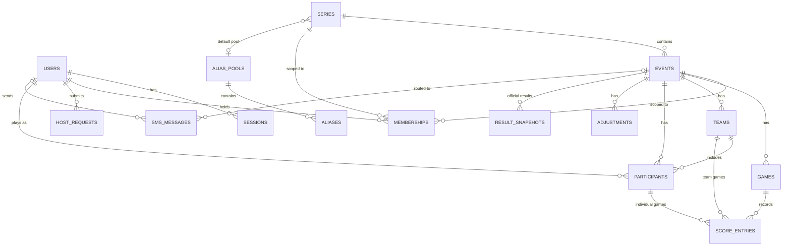

# Scorebot 9000: Modernization Plan

**Status:** Draft v3: Fly + PlanetScale Postgres, prefixed UUIDv7 IDs, admin gate (decisions in §2)
**Based on:** `master` at `976d813` (Clinelympics 2021)
**Last updated:** 2026-11-20

---

## 1. Summary

Rebuild Scorebot 9000 as a **Rails 8 + Hotwire** app on **one stateless, auto-stopping Fly.io machine**, backed by **PlanetScale Postgres** (the same pairing as your other app). Cloudflare handles DNS, proxying and R2 file storage. Idle running cost is a few dollars a month, and Twilio is the largest line item (§12).

The current single-purpose Clinelympics site becomes a small event-hosting platform:

- **Platform → Series → Event → Game.** The Scorebot 9000 homepage lists events and series. "Clinelympic Games" becomes a series, and **clinelympics.com becomes that series' custom domain**. Each year becomes an event with its own homepage, rules, schedule, theme and results.
- **Hosting.** Anyone can request to host. Approval is gated with Flipper. SMS for a host's events is also flagged in per host.
- **Relational schema** with **UUIDv7 primary keys** and **prefixed public IDs** (`usr_01jdk3m8v9e7t2h5q4w6x8y0z1`, TypeID format).
- **Passwordless sign-in by phone or email.** One account can have both.
- **Twilio stays, on the same 909-SCORE-11 number**, registered for A2P 10DLC as a Sole Proprietor.
- **Configurable scoring engine.** Finished events always show **what was announced**, stored as frozen snapshots.
- **Brand-new UI**: mobile-first, with live results and a TV mode.
- **Ops tooling.** **Flipper**, **Blazer**, **Maintenance Tasks** and Mission Control all sit behind a **platform-admin gate** from day one (§7.4).
- **Staged rollout.** First move the archive to the new stack and retire the insecure legacy app. Then build event features. Then open hosting.

---

## 2. Decisions so far

| Topic | Decision |
|---|---|
| Stack | Rails 8 + Hotwire |
| Hosting | Optimize for lowest running cost → **Fly.io** (app) + **PlanetScale Postgres** (DB) |
| Database | Postgres, not SQLite (durability) |
| IDs | **UUIDv7** for every primary key; models with a public face get **prefixed IDs** (TypeID: `usr_…`, `evt_…`) |
| Admin tooling | Flipper, Blazer, Maintenance Tasks and Mission Control are **all behind a platform-admin gate** |
| DNS | **Cloudflare** (clinelympics.com) |
| Platform domain | `scorebot9000.fly.dev` for now |
| Timeline | No deadline; nothing to backfill beyond the 10 legacy events |
| Hosting access | Anyone can host eventually; gated approval list for now |
| SMS for other hosts | Enabled per host user via a Flipper flag |
| Current prod | `clinelympics.com`, still live, GCP project `clinelympics`, owner has admin access |
| Twilio | **Keep the 909 number**; register A2P 10DLC (Sole Proprietor) |
| Historical results | **What was shown and announced wins.** Small score adjustments are acceptable to make the data agree. |
| Aliases | Random aliases are an *event setting*; players may override their alias |
| Legacy SMS logs | Import them |
| Platform admin | A Google-account email, granted at bootstrap (not committed to the repo) |

---

## 3. What exists today

| Area | Current state |
|---|---|
| Runtime | App Engine standard, `java8` runtime, servlets + JSP scriptlets. About 5k lines. |
| UI | Bootstrap 2, jQuery `.live()`, Google Analytics `ga.js` (Universal Analytics, which is shut down) |
| Data | Cloud Datastore. There are 7 kinds, and every entity of a kind hangs off one hard-coded ancestor key (e.g. all events are children of `Events/eventList`). Relationships are integer/phone properties joined by hand in JSPs. |
| Auth | App Engine Users API. A single admin is identified by Google nickname in a singleton `setting` entity. |
| SMS | Twilio webhook → `/inbound` → TwiML reply |
| Scoring | Copy-pasted across `summary.jsp`, `medals.jsp` and `scores.jsp` (about 300 lines each), plus `Medal.java` |
| Event content | Hard-coded in `index.jsp` and `details.jsp`: 2021 dates, game list, rules, past-results links |

### 3.1 Current data (Datastore kinds)

| Kind | Fields | Notes |
|---|---|---|
| `setting` | `adminName`, `adminNumName`, `eventID`, `siteName` | Singleton. `eventID` = "current event" (`-1` = none) |
| `event` | `eventID`, `eventName`, `medals` (CSV), `active`, `archived`, `teamscore`, `teams` | All 10 prod events: teams = yes, team scoring = yes |
| `game` | `eventID`, `gameID` (1..n per event), `gameName`, `scoreType` (true = high wins) | `gameID` is the number players text in `SCORE <id> <n>` |
| `player` | `eventID`, `playerID` (phone, or free text if an admin added the player), `playerName` (alias), `teamName` (UPPERCASED) | One row per person per event. Identity across years exists only through the phone number. |
| `score` | `eventID`, `playerID`, `gameID`, `playerScore` (int), `date` | Upserted: re-texting overwrites. Integers only. |
| `name` | `Name`, `rnd`, `isUsed` | Global alias pool. `isUsed` is reset when an event is activated. |
| `text` | `SmsSid`, `AccountSid`, `From`, `Body`, `date` | Inbound SMS log (the admin simulator writes here too) |

### 3.2 Current scoring behavior (to reproduce for history)

Every production event used **team scoring**:

1. Each player has at most one integer score per game. The latest submission wins.
2. **A team's score for a game is the sum of its members' scores.** This is why the rules said "only one player per team submits for team games" and why teams had to be the same size.
3. Per game, *distinct* team totals are ranked (higher or lower is better, set per game). The top 3 distinct values get Gold, Silver and Bronze. **Ties share a medal and don't use up a slot** (dense ranking: 10, 10, 8 → Gold, Gold, Silver).
4. Team points = Σ (number of tiers − tier index): **Gold 3, Silver 2, Bronze 1**.
5. Standings sort by points, then golds, then silvers, then bronzes, then team name. The name tiebreak is *reverse* alphabetical, an accident of `Medal.compareTo`.

Individual-scored events (supported, but unused in prod) total medals **unweighted**, which is inconsistent with team mode.

### 3.3 Problems to fix rather than port

**Security (relevant now, because the site is live):**
- `/add` (all admin writes and deletes) checks only a **client-supplied `userEmail` header** against the admin's nickname (`AddServlet.java:47`). Anyone who guesses it can create, edit or delete data.
- `/inbound` doesn't validate Twilio's signature. Anyone can POST as any phone number, including the admin number that runs `ADMIN START/STOP`.

**Correctness:**
- The tie check in `Medal.addScore` uses `String.contains` on a comma-joined name list (`Medal.java:54`). A tied competitor whose name is a substring of another (e.g. `BEAR` and `BEARS`) gets pushed down a medal. Names containing `", "` break the medal-count split.
- Medal counts are keyed by alias, not ID (`medals.jsp:203`), so duplicate aliases merge.
- Alias assignment isn't transactional and uses a global `isUsed` flag.
- `REGISTER` with no aliases left → `Random.nextInt(0)` throws (`InboundServlet.java:87`). `CHANGE` or `ADMIN` alone → `ArrayIndexOutOfBounds` (`:163`, `:256`). Re-registering silently does nothing.
- Integer-only scores. Admin score entry looks up the game without an event filter (`AddServlet.java:98`). `details.jsp` documents `CHANGE NAME <new name>`, but the code ignores the name.

**Platform:**
- The `java8` App Engine runtime reached end of support in January 2024, and Google has said it will block deploys of end-of-support runtimes. The app may already be impossible to redeploy.
- The Twilio number isn't 10DLC registered, so US carriers block its outgoing replies (§9.5).

---

## 4. Goals and non-goals

**Goals**
1. **Lowest practical running cost:** near-zero compute while idle (which is most of the year), on a durable managed database, with no surprise bills.
2. A generic event platform: platform, series and event homepages, with all content editable in the app.
3. Sign in with phone or email, and link legacy phone-only players to emails.
4. Keep Twilio SMS scoring on the same number, backward compatible with `REGISTER`, `SCORE 1 228`, etc.
5. A relational data model with enforced integrity, UUIDv7 keys and prefixed public IDs.
6. Configurable scoring, with official results frozen as announced.
7. A new, mobile-first UI with live results.
8. Self-serve hosting for others, gated for now.

**Non-goals (for now):** payments and ticketing, native apps, a bracket builder (bracket games record final placements, §8.4), bring-your-own-Twilio for other hosts.

---

## 5. Recommended stack

| Concern | Choice | Why |
|---|---|---|
| Framework | Rails 8.1, Ruby 4.0 | Mostly forms and CRUD; you know it |
| Frontend | Hotwire (Turbo + Stimulus), importmap, `tailwindcss-rails` | Server-rendered, with no JS build pipeline |
| **Database** | **PlanetScale Postgres** (one database for app + Solid Queue + Solid Cable) | Durable, managed backups, and the same setup you already run |
| IDs | UUIDv7 PKs + TypeID prefixed public IDs (§6.1) | Time-ordered keys (index-friendly; `first`/`last` stay meaningful), readable typed IDs in URLs, logs and the admin UI |
| Live updates | Turbo 8 morph refreshes broadcast over Action Cable via **Solid Cable** (on Postgres) | Live scoreboard with no Redis |
| Jobs | **Solid Queue** in Puma (`SOLID_QUEUE_IN_PUMA`) + Mission Control – Jobs | One machine, no worker fleet |
| Cache | Memory store (single machine) | Standings caching; no Solid Cache tables needed |
| Auth | Rails 8 authentication generator, extended for passwordless OTP | Small and built in |
| Authorization | Action Policy (or Pundit), backed by a `memberships` table | Per-series and per-event roles |
| Feature gates | **Flipper** (Active Record adapter + UI) | Hosting approval, per-host SMS, kill switches, rollouts (§7.5) |
| Prod queries | **Blazer** on a read-only Postgres role | Ad-hoc SQL and canned reports (§12.6) |
| Imports and data fixes | **Maintenance Tasks** | Legacy import, CSV mappings, reconciliation, admin grants (§11) |
| SMS | `twilio-ruby`, `Rack::TwilioWebhookAuthentication`, Twilio Verify | Signature validation is one line of middleware |
| Phones | `phonelib` | E.164 normalization |
| Content and files | Action Text; Active Storage → Cloudflare R2 | Free egress; keeps the app machine stateless |
| PII | Active Record Encryption (deterministic) for phone and email | Queryable and uniquely indexable; shows as ciphertext in Blazer by default |
| Email | Resend (free tier) or Amazon SES (pennies) | OTP codes and magic links |
| Tests | Minitest, system tests, golden-master scoring tests | |

---

## 6. Domain model

### 6.1 ID conventions

- **Every primary key is a native Postgres `uuid` holding a UUIDv7.** IDs are minted in Ruby (`SecureRandom.uuid_v7` in an `ApplicationRecord` `before_create`), so they are known before insert. If the PlanetScale cluster runs Postgres 18, columns also default to the native `uuidv7()` as a backstop for `insert_all`/`upsert_all` and raw SQL. On Postgres 17, the importer passes IDs explicitly.
- **Prefixed public IDs use the [TypeID](https://github.com/jetify-com/typeid) format:** `prefix_` + the UUIDv7 encoded as 26 Crockford base32 characters.
  - The prefixed form is a **reversible encoding of the stored UUID**, so there is no extra column, no secret, and no lookup table.
  - A small `PrefixedId` concern (using a TypeID Ruby library, or about 40 lines of base32) provides `id_prefix :usr`, `#public_id`, `to_param`, and `find_by_public_id!` (which rejects a wrong prefix).
  - The prefixed form is used everywhere outside the database: URLs, params, logs, emails, Flipper actor IDs (`flipper_id` returns `usr_…`, so you can paste it into the Flipper UI), Maintenance Task inputs, and error reports.
  - The `prefixed_ids` gem doesn't fit: it hashes integer IDs. With UUIDv7 keys, TypeID is the direct equivalent of the "prefixed ULID" idea.
- **Prefixes:**

  | Model | Prefix | | Model | Prefix |
  |---|---|---|---|---|
  | User | `usr` | | ScoreEntry | `scr` |
  | Series | `ser` | | Adjustment | `adj` |
  | Event | `evt` | | ResultSnapshot | `snap` |
  | Game | `game` | | Membership | `mbr` |
  | Team | `team` | | HostRequest | `hreq` |
  | Participant | `ptc` | | SmsMessage | `sms` |
  | AliasPool | `apool` | | | |

- **Unprefixed (internal) tables use plain UUIDv7:** `sessions`, `sign_in_codes`, `aliases`, `admin_audit_events`.
- **Third-party engine tables keep their own IDs** (Solid Queue, Solid Cable, Flipper, Maintenance Tasks, Blazer queries). They never hold foreign keys to app records, *except*:
  - **Active Storage and Action Text** use polymorphic `record_id`. Set `config.generators { |g| g.orm :active_record, primary_key_type: :uuid }` *before* running their installers so `record_id` is generated as `uuid`.
  - **Blazer**'s install migration references `users` (`creator_id`, audit `user_id`). Edit it to `type: :uuid`.
- Legacy integer IDs are kept as `legacy_*` columns. Imported rows get UUIDv7s **minted from their legacy timestamps**, so ID order matches history.
- Public pages prefer slugs and numbers where humans type them: `/e/clinelympics-2021`, `/e/…/games/3`. Prefixed IDs appear in other URLs (teams, participants, the admin area).

### 6.2 Concepts

- **User**: one human, with optional `email` and optional `phone` (at least one), and an optional platform-admin flag.
- **Series**: a recurring brand ("Clinelympic Games"). It has a homepage, branding, an optional **custom domain**, editions, and all-time stats.
- **Event**: one occurrence ("2021 Clinelympic Games"). It belongs to a series or stands alone. It has a homepage, schedule, rules, team settings, alias settings, scoring config, an SMS code and a lifecycle status.
- **Game**: a competition inside an event. Its `position` is the number players text.
- **Team**, **Participant** (a user's registration in an event: alias and team), and **Score entry** (append-only).
- **Adjustment**: manual points with a reason.
- **Result snapshot**: frozen official standings.
- **Membership**: a role on a series or event.
- **Host request**: an application to host, reviewed by the platform admin.
- **Alias pool / alias**, **SMS message** (inbound and outbound log), and **Admin audit event**.

### 6.3 ERD



### 6.4 Tables (key columns and constraints)

All PKs and FKs are `uuid`. Case-insensitive uniqueness uses expression indexes (e.g. `unique (event_id, lower(name))`). Flexible config uses `jsonb`.

**users**: `name`, `email` (normalized, encrypted deterministic, unique, nullable), `phone` (E.164, encrypted deterministic, unique, nullable), `pending_email` (set by organizer mapping until verified), `email_verified_at`, `phone_verified_at`, `platform_admin` (bool), `sms_context_event_id`, `legacy_admin_nickname`. CHECK (email or phone present).

**sessions**: from the Rails 8 generator.

**sign_in_codes**: email OTP only (phone OTP is handled by Twilio Verify). Columns: `email`, `code_digest`, `expires_at`, `attempts`, `consumed_at`.

**series**: `slug` (unique), `name`, `tagline`, Action Text `description`, `logo`/`hero` (Active Storage), `theme` (jsonb), **`custom_domain`** (unique, nullable, e.g. `clinelympics.com`), `default_alias_pool_id`.

**events**:
- `series_id` (nullable), `slug` (unique), `name`, `edition_label` ("2021")
- `starts_at`, `ends_at`, `time_zone`, `location_text`, `online_url`
- Action Text `description`, `rules`, `schedule`
- `status` enum: `draft → published → live → final → archived`. This replaces `active`, `archived` and the global "current event".
- `registration_open`, `sms_code` (unique, e.g. `CLINE27`)
- `team_mode`: `none | self_registered | assigned`; `max_team_size`
- **`alias_mode`**: `random | self_chosen | real_name`; **`allow_alias_override`** (bool, default true)
- `scoring` (jsonb, validated by `Scoring::Config`, §8), `alias_pool_id`, `theme` (jsonb), `legacy_event_id` (unique, nullable)

**games**:
- `event_id`, `position` (unique per event), `name`, Action Text `description`, `scheduled_at`
- `direction`: `higher_better | lower_better`
- `score_format`: `integer | decimal | time | placement`
- `participation`: `individual | team` (who submits)
- `team_aggregation`: `sum | average | best | top_n_sum | median`, plus `team_aggregation_n`
- `attempt_policy`: `latest | best | average`
- `weight` (default 1.0), `status`: `upcoming | open | locked | final`
- `legacy_game_id`

**teams**: `event_id`, `name` (unique per event, case-insensitive), `color`, `emoji`.

**participants**: `event_id`, `user_id`, `team_id` (nullable), `alias` (unique per event, case-insensitive), `alias_source` (`random | chosen | real_name | import`), `registered_via` (`sms | web | organizer | import`). Unique (`event_id`, `user_id`).

**score_entries**:
- `game_id`, `participant_id` or `team_id` (CHECK exactly one)
- `value numeric(14,3)`, `raw_input`
- `source` (`sms | web | organizer | import | reconciliation`), `note`, `submitted_by_user_id`, `voided_at`, `voided_by_user_id`, `created_at`
- Append-only. The game's `attempt_policy` picks the effective value. "Undo" and deletes set `voided_at`.

**adjustments**: `event_id`, `participant_id` or `team_id`, `points`, `reason`, `created_by_user_id`.

**result_snapshots**: `event_id`, `computed_at`, `scoring_config`, `standings`, `game_results` (jsonb), `official` (bool), `source` (`computed | legacy_capture`). Snapshots reference competitors by public ID, so series all-time stats can aggregate them.

**memberships**: `user_id`, `resource_type`/`resource_id` (Series or Event), `role`: `owner | organizer | scorekeeper`.

**host_requests**: `user_id`, `message`, `status` (`pending | approved | declined`), `reviewed_by_user_id`, `reviewed_at`.

**alias_pools** / **aliases**: `alias_pools(name, owner_type, owner_id)`, `aliases(alias_pool_id, name)`.

**sms_messages**: `direction`, `twilio_sid` (unique, so webhook handling is idempotent), `from`, `to`, `body`, `user_id`, `event_id`, `command`, `status`, `error`, `legacy` (bool), `created_at`.

**admin_audit_events**: `user_id`, `action` (e.g. `flipper.enable`), `subject` (e.g. `sms_scoring:usr_…`), `metadata` (jsonb), `created_at`.

---

## 7. Identity, roles, admin gate and hosting access

### 7.1 Sign-in (phone or email)

1. A single field: **"Email or mobile number"**. If it contains `@`, treat it as an email. Otherwise use `phonelib` (default US) to get E.164.
2. Send a 6-digit code:
   - **Phone:** Twilio Verify (about $0.05 per successful verification). It sends from Twilio's own registered senders, independent of the 909 number's campaign. Its Fraud Guard blocks SMS-pumping attacks, which are the real cost risk on an open sign-in form.
   - **Email:** Action Mailer sends a code plus a magic link via Resend or SES. This is essentially free, so the UI nudges toward email where both are on file.
3. On success, find or create the user and start a session. Sign-up and sign-in are the same flow.
4. Throttle with Rails 8 `rate_limit`, Verify's limits, and **Twilio geo permissions restricted to US/Canada**.

### 7.2 Linking legacy phones to emails

- **Self-serve:** sign in by phone, then go to Account → "Add email" and verify it.
- **Organizer mapping:** a Maintenance Task takes a CSV upload of `phone,email` and sets `pending_email` on the matching users. Their first email sign-in verifies it and links it.
- **Merge:** verifying a phone and an email that belong to two accounts, in one session, merges them. There is also an admin-side merge task.
- Texting the event number creates or uses a phone-only user. Web sign-in always requires a code.

### 7.3 Roles

| Role | Scope | Can |
|---|---|---|
| Platform admin | everything | Everything, including the admin area (§7.4) |
| Owner / organizer | series or event | Manage content, games, teams, participants, scores and lifecycle |
| Scorekeeper | event | Enter and void scores only |
| Participant | event | Register, pick a team, set an alias (if allowed), submit own or team scores (if allowed) |

### 7.4 Admin area and gate

All operator tooling lives under `/admin` and requires a **signed-in user with `platform_admin = true`**. Everyone else, signed in or not, gets a **404**, so the tools' existence isn't revealed. The gate exists from Phase 1: email-code sign-in is built in Phase 1 for exactly this reason, so there is never a basic-auth stopgap or an open window.

**Route-level gate**: a single constraint wraps every mount and admin controller:

```ruby
# config/routes.rb
constraints(AdminConstraint) do        # session cookie → Session → user.platform_admin?
  mount Flipper::UI.app(Flipper)     => "/admin/flipper"
  mount Blazer::Engine               => "/admin/blazer"
  mount MaintenanceTasks::Engine     => "/admin/maintenance_tasks"
  mount MissionControl::Jobs::Engine => "/admin/jobs"
  namespace :admin do
    root "dashboard#show"
    resources :host_requests, only: %i[index update]
    resources :series_domains, only: %i[index update]
  end
end
```

**Controller-level defense in depth**, so a routing mistake alone can't expose anything:
- `Admin::BaseController` has `before_action :require_platform_admin!` (404 otherwise).
- Maintenance Tasks: `MaintenanceTasks.parent_controller = "Admin::BaseController"`, plus `MaintenanceTasks.metadata` records the admin's `usr_…` ID on every run.
- Mission Control – Jobs: `base_controller_class = "Admin::BaseController"`, with its built-in HTTP basic auth turned off.
- Blazer: `before_action_method: require_platform_admin!`, `user_class: User`, `user_method: current_user` (so query audits record who ran what), and a **read-only Postgres role** for its connection.
- Flipper UI is a plain Rack app, so the route constraint is its gate. Flipper changes are written to `admin_audit_events` via Flipper's ActiveSupport instrumentation.

**Tests:** a request test hits every mount and admin route as anonymous, as a regular user and as a platform admin, and asserts 404 / 404 / 200. Any future route change that exposes a tool fails CI.

**Bootstrap:** the first admin is granted from a shell, because the Maintenance Tasks UI is itself behind the gate:

```bash
fly ssh console -a scorebot9000 -C "bin/rails users:grant_admin EMAIL=you@example.com"
```

After that, `Users::GrantPlatformAdminTask` (in the admin UI) grants or revokes others. The email is never committed.

### 7.5 Flipper usage

Flipper is for **gates, kill switches and rollouts**. Per-record permissions ("organizer of event X") live in `memberships` with Action Policy.

| Flag | Actor(s) | Purpose |
|---|---|---|
| `hosting` | user; group `platform_admins` | Can create series and events. Approving a host request enables this flag for that user. |
| `sms_scoring` | **user** (the host); group `platform_admins` | SMS commands are accepted for events owned by a user with this flag (an owner of the event, or of its series). Platform-admin controlled, because texts cost money on *your* Twilio account. |
| `pause_sms_inbound` | global | Kill switch: when enabled, inbound SMS is logged but not processed |
| `pause_phone_login` | global | Kill switch: when enabled, sign-in falls back to email only if Verify spend spikes |
| `sms_broadcasts` | global or user | Staged rollout of proactive SMS broadcasts |

`Flipper.register(:platform_admins) { |actor| actor.respond_to?(:platform_admin?) && actor.platform_admin? }`. `User#flipper_id` returns the prefixed ID.

### 7.6 Gated hosting flow

1. A signed-in user clicks **"Host an event"**. Without `hosting`, they see a short request form (creates a `host_request`).
2. You get an email and a row in `/admin/host_requests`. Approve (enables `hosting` for that user) or decline.
3. Their events are **web-scoring only** until you enable `sms_scoring` for them in Flipper. Read the campaign-scope note in §9.5 before doing this for many hosts.
4. Later, "open the gate" by enabling `hosting` for everyone, once per-host SMS caps and basic abuse controls exist (Milestone C).

---

## 8. Scoring engine

### 8.1 Design

`Scoring::Engine` is **pure Ruby with no database access**. It takes plain data and returns standings, so it's fast, easy to test exhaustively, and identical between live views and snapshots.

```ruby
result = Scoring::Engine.new(Scoring::Config.from(event.scoring)).call(
  games:       [...],  # direction, participation, team_aggregation, attempt_policy, weight, score_format
  competitors: [...],  # participants (with team_id) and teams
  entries:     [...],  # non-voided score entries
  adjustments: [...]
)
result.standings     # ordered rows: competitor, place, medal counts, points, tiebreak values
result.game_results  # per game: ranked rows (place, medal, effective value) and stats (n, mean, median, best)
```

### 8.2 Pipeline

1. **Effective score** per (game, competitor), using `attempt_policy`: `latest` (legacy), `best` or `average`.
2. **Team rollup** for individual games when standings are team-based. Options: `sum` (legacy), `average` (fixes uneven teams), `best`, `top_n_sum`, `median`, plus a missing-member policy (`ignore | count_as_zero`).
3. **Rank each game** by direction. Tie modes: `competition` (1, 2, 2, 4; the default) or `dense` (1, 2, 2, 3; legacy).
4. **Award** per game, multiplied by the game's `weight`: medals for the top N places, and/or placement points (e.g. `[10, 8, 6, 5, 4, 3, 2, 1]` or "N − place + 1"), and/or a normalized 0–100 score relative to the best and worst value.
5. **Standings method**:

   | Method | Description |
   |---|---|
   | `medal_table` | Olympic style: golds, then silvers, then bronzes |
   | `weighted_medals` | Sum of medal points (legacy team mode: 3/2/1) |
   | `medal_count` | Total medals (legacy individual mode) |
   | `placement_points` | Sum of placement points |
   | `average_rank` | Mean place across games, with a minimum-games rule and a penalty place for skipped games |
   | `normalized_average` | Mean of normalized 0–100 game scores |

6. **Adjustments** are added afterward and shown openly.
7. **Tiebreakers**: an ordered list, e.g. `[golds, silvers, bronzes, best_single_place, name]`.

### 8.3 Config (`events.scoring` jsonb)

```yaml
basis: team                 # team | individual
ranking: competition        # competition | dense
medals:
  - { name: Gold,   points: 3, color: "#D4AF37" }
  - { name: Silver, points: 2, color: "#A8A9AD" }
  - { name: Bronze, points: 1, color: "#CD7F32" }
standings: weighted_medals
placement_points: [10, 8, 6, 5, 4, 3, 2, 1]
missing_scores: ignore      # ignore | worst_place | zero
tiebreakers: [golds, silvers, bronzes, name]
show_individual_standings: true
```

**Presets:** "Olympic medal table", "Weighted medals", "Placement points", "Average rank", and **"Legacy Clinelympics (2012–2021)"**. The legacy preset is `basis: team`, `ranking: dense`, 3/2/1 medals, `weighted_medals`, games `individual` + `sum` + `latest`, and a reverse-alphabetical final tiebreak.

### 8.4 Score formats

`integer`, `decimal`, `time` (accepts `1:23.45` or `83.45`), and `placement` (the organizer enters the final place; covers bracket games like 2021's "Bracketeering"). Later idea: a `votes` format with in-app voting, replacing the external "vote here" link used for Contemporary Art.

### 8.5 Official results, and what was announced

- **Finished events always render from their official snapshot.** Series all-time stats aggregate official snapshots too. Later engine changes can never rewrite history.
- For the 10 legacy events, the official snapshot is the **captured legacy page output** (§11.3), mapped to competitor IDs. That makes "what was shown and announced" the source of truth by construction.
- The importer also recomputes each event with the legacy preset and reports any differences. `Legacy::ReconcileResultsTask` can apply the smallest score nudges so that recomputation matches too. Each nudge is a new `score_entry` with `source: reconciliation` and a note, and the original is voided rather than overwritten. This is the agreed "fudge", and it is fully auditable. It's optional, because display already uses the snapshot.

### 8.6 Verification

Unit tests per stage and option (ties, empty games, uneven teams, voided entries); golden-master tests for the 10 legacy events; and optional property tests (input order never changes results).

---

## 9. SMS (Twilio)

### 9.1 Inbound flow

```
Twilio ──POST──▶ https://scorebot9000.fly.dev/twilio/sms
                 (direct to Fly, not through the Cloudflare proxy; see 10.2)
  1. Rack::TwilioWebhookAuthentication validates X-Twilio-Signature (403 if invalid)
  2. Insert sms_messages row (unique MessageSid, so retries are no-ops)
  3. Flipper kill switch (pause_sms_inbound) check
  4. Resolve the user by From (create a phone-only user if new)
  5. Resolve the event (9.2) and check sms_scoring for its owner
  6. Sms::CommandParser → command object → the same services the web UI uses
     (Participants::Register, Scores::Submit, Teams::Change, Participants::Rename, ...)
  7. Reply with TwiML (Twilio::TwiML::MessagingResponse) and log the outbound row
```

### 9.2 Event routing

1. `JOIN <code>` sets the sender's SMS context to that event.
2. If the sender is a participant in exactly one live event, use it.
3. If the receiving number (`To`) is assigned to an event, use it.
4. If exactly one live, SMS-enabled event exists, use it. This is the common case and matches today's behavior.
5. Otherwise reply: "Which event? Text JOIN followed by the event code."

### 9.3 Commands

Existing commands keep working unchanged.

| Command | Behavior |
|---|---|
| `REGISTER [team]` | Join the event (with a team if self-registered teams are on). The alias follows the event's `alias_mode`. Re-registering replies with your current info. |
| `JOIN <code> [team]` | Same, for an explicit event |
| `SCORE <game#> <value>` | Submit a score. The value may be decimal or `m:ss`. Rejected if the game is locked. Any member can submit for a team game. |
| `UNDO` | Void your last submission |
| `WHO` / `ME` | Your alias, team and scores |
| `GAMES` | Game numbers and names |
| `STANDINGS` | The top 3, plus your or your team's position |
| `CHANGE TEAM <name>` | Switch teams (if allowed) |
| `CHANGE NAME <name>` | Set your own alias (if `allow_alias_override`) |
| `CHANGE NAME` | New random alias (if `alias_mode: random`) |
| `COMMANDS` / `?` | Command list |
| `ADMIN START\|STOP [code]`, `ADMIN LOCK <game#>` | Organizers of the routed event only |

The parser is case-insensitive and whitespace-tolerant. It answers with a helpful error instead of raising.

A number we haven't seen gets an account only when its text is a `REGISTER` or `JOIN` that succeeds for an event taking registrations; the account and the registration are created in one transaction. Any other text from an unknown number gets a pointer to `REGISTER` (or `JOIN <code>`), and nothing is stored beyond the message log.

### 9.4 Reserved keywords

`STOP`, `START`, `HELP` and similar words, sent as the whole message, are carrier opt-out keywords handled by Twilio. Configure **Advanced Opt-Out** on the Messaging Service so `HELP` returns the command list, and keep `COMMANDS` / `?` as aliases.

### 9.5 Keeping 909-SCORE-11: A2P 10DLC Sole Proprietor

US carriers block unregistered application traffic from 10-digit local numbers, and replies count. The decision is to keep the number, so:

1. **Phase 0, brand:** In Twilio Trust Hub, register a **Sole Proprietor** brand: your legal name, address and email, plus a US/CA mobile number (not VoIP) that receives a verification code. No EIN is needed.
2. **Phase 1, Messaging Service:** create one, add the 909 number, and set the inbound webhook on the service. Configure Advanced Opt-Out (`HELP` text).
3. **Phase 1, campaign:** submit once `/privacy` and `/sms-terms` are live on the new app. Include:
   - the use case (score tracking for live events)
   - the opt-in flow (users opt in by texting `REGISTER` or `JOIN` to the number, which is published on the event page with SMS terms)
   - sample messages, and the help and opt-out keywords
4. **Wait for approval** (days to a few weeks). Until then inbound works, but replies may be blocked. Web scoring works regardless.

**Approximate costs** (check current Twilio pricing): brand and campaign vetting about $20 one-time, campaign about $2 a month, number about $1.15 a month.

**Sole Proprietor limits:** one campaign, one number, and low daily throughput. That's fine for parties.

**Campaign-scope caveat:** a Sole Proprietor campaign is meant for *your own* messaging. Enabling `sms_scoring` for an occasional friend's event is in the spirit of it. If other hosts' events start sending meaningful SMS volume through your number, carriers may treat that as platform (ISV) traffic, which generally needs a standard brand with an EIN. Revisit before turning SMS on for many hosts.

**Cost controls:**
- No second Twilio number for staging. Point the idle production number's webhook at staging during development, and use the simulator.
- US/CA geo permissions; `sms_scoring` per host and `pause_sms_inbound` as a kill switch.
- Broadcasts come later behind `sms_broadcasts`.

---

## 10. Product and UI

### 10.1 Direction

- **Mobile-first.** Big tap targets; the first screen answers "how are we doing?".
- **A sports-broadcast feel:** large numerals, podiums, team colors, smooth live updates.
- **Two visual layers.** The platform has its own Scorebot 9000 brand, and each series or event has its own theme (accent color, logo, hero). Clinelympics keeps its flag and emblem look.
- Tailwind with a small component set, dark mode, accessible tables.

### 10.2 Domains, routing and Cloudflare

| Host | Serves |
|---|---|
| `scorebot9000.fly.dev` | The platform homepage and all routes; the Twilio webhook target |
| `clinelympics.com` (+ `www`), series `custom_domain` | `/` = the Clinelympics series page. `/2021` or `/e/clinelympics-2021` = event pages. Legacy JSP paths redirect (10.4). |

Rails picks the series by `request.host` with a routing constraint. Custom domains are a platform-admin-only setting.

**Cloudflare setup for `clinelympics.com`:**
- `fly certs add clinelympics.com` (and `www`). Add the `_acme-challenge` CNAME Fly provides, so certificates issue and renew via DNS validation even while proxied.
- Apex `CNAME` (Cloudflare flattens it) or `A`/`AAAA` from `fly ips list`, plus a `www` CNAME. **Proxied (orange cloud)**, with SSL mode **Full (strict)**. WebSockets are on by default.
- **Bot Fight Mode on:** fewer bot hits waking the Fly machine.
- Optional: a Cache Rule plus `Cache-Control: public, s-maxage=…` on **final and archived event pages only**, so the archive is served from Cloudflare's edge without waking the machine. Purge on edit.
- **The Twilio webhook points at the `fly.dev` hostname**, not `clinelympics.com`, so Cloudflare bot protection can never challenge Twilio's POSTs, and signature validation sees the exact URL Twilio signed.

### 10.3 Pages

**Public**

| Route | Page |
|---|---|
| `/` (platform) | What Scorebot 9000 is; **Live now**, upcoming events, recent results, featured series; sign in; "Host an event" |
| `/s/:series` (or `/` on its custom domain) | Series home: editions timeline, champions by year, all-time medal table by person, records per recurring game |
| `/e/:event` | Event home: hero, date, time and location, description, schedule, rules, numbered games, auto-generated **"How to play by text"** (shown when SMS is enabled), register CTA, live standings widget |
| `/e/:event/results` | Live standings: podium, full table, team/individual toggle, per-game medal grid |
| `/e/:event/games/:n` | Game detail: ranked scores, medals, stats (mean, median, best) |
| `/e/:event/teams/:team_id` | Team page (`team_…` ID) |
| `/e/:event/tv` | **TV mode**: rotating standings, latest-scores ticker |
| `/privacy`, `/sms-terms` | Required for the 10DLC campaign |

**Participant:** `/me` (my events, history, linked identifiers, alias override), `/e/:event/join`, and score submission on the event page (mirrors SMS).

**Organizer console (`/manage`):**
- Event setup wizard: basics → content → teams → **aliases** (random / self-chosen / real names, override allowed) → games → scoring preset with a preview → publish
  - The scoring preview recomputes standings as settings change, using the event's own scores once it has some and otherwise a sample event in `db/scoring_samples/default.json`. The committed sample is synthetic. After the legacy import, replace it with a scrub of a real Clinelympics year: `bin/rails scoring:export_sample EVENT=clinelympics-<year>` renames teams and players to "Team N" and "Player N" and keeps the game settings and score values.
- Games builder with drag-to-reorder; renumbering is locked once live
- Teams: create, recolor, **randomize or balance** ("teams of 2, one team of 3 if odd"), drag players between teams
- Participants: add manually, edit aliases, merge duplicates
- **Score grid**: spreadsheet-style keyboard entry, with void and audit trail
- Adjustments; lifecycle controls (Publish, Open registration, Go live, Lock game, **Finalize**, Archive)
- SMS log and **simulator** (successor to today's Texts tab); co-organizers and scorekeepers; alias pools

**Platform admin (`/admin`, gated per §7.4):** dashboard, host requests, series custom domains, Flipper, Blazer, Maintenance Tasks, Mission Control – Jobs.

### 10.4 Legacy URL redirects (on `clinelympics.com`)

| Old | New |
|---|---|
| `/index.jsp` | `/` (series page) |
| `/summary.jsp?e=N`, `/medals.jsp?e=N`, `/scores.jsp?e=N` | `/<year>/results` for legacy event N (matching tab) |
| `/summary.jsp`, `/medals.jsp`, `/scores.jsp` (no `e`) | Latest edition's results |
| `/details.jsp` | Latest edition's home |
| `/admin.jsp` | `/manage` |
| `/inbound` | `/twilio/sms` |

---

## 11. Data migration

### 11.1 Export (Phase 0)

Run from your machine (owner access on project `clinelympics`):

```bash
gcloud config set project clinelympics
```

```bash
gcloud storage buckets create gs://clinelympics-legacy-export --location=US
```

```bash
gcloud datastore export gs://clinelympics-legacy-export/$(date +%F)
```

- This is the **backup of record**: restorable, and loadable into BigQuery (`bq load --source_format=DATASTORE_BACKUP`) if ever needed. Bucket names are global, so pick another if that one is taken. Managed export may require billing to be enabled on the project.
- **Working dump:** `script/legacy/dump_datastore.rb` uses the `google-cloud-datastore` gem with `gcloud auth application-default login`. It queries each kind under its ancestor key and writes `<kind>.jsonl`. These files contain phone numbers, so they **never go in git**. Store them in a private R2 bucket.
- After cutover, copy the managed export to R2. The GCP project can then be shut down entirely.

### 11.2 Import (Maintenance Tasks, behind the admin gate)

The import is a set of idempotent, resumable tasks. Each upserts on legacy IDs and shows progress in `/admin/maintenance_tasks`. They run in dependency order, reading the JSONL dump attached via Active Storage:

| Task | Legacy → New |
|---|---|
| `Legacy::ImportEventsTask` | `event` → series "Clinelympic Games" (`custom_domain: clinelympics.com`) plus events (slug `clinelympics-<year>`, `status: final`/`archived`, medal tiers from the CSV with points N..1, `team_mode` from `teams`, legacy preset, `alias_mode: random`). **Dates aren't stored in legacy data**, so derive `starts_at` from the earliest score or text per event, then correct it by hand. |
| `Legacy::ImportGamesTask` | `game` → games (`position = gameID`, `direction` from `scoreType`, `individual` + `sum` + `latest`, `integer`) |
| `Legacy::ImportPlayersTask` | `player` → users deduplicated by normalized phone **across all events**, teams (find or create by event + case-insensitive name, title-cased), participants (`alias = playerName`, `alias_source: import`) |
| `Legacy::ImportScoresTask` | `score` → score entries (`source: import`, `created_at = date`, UUIDv7 minted from `date`). Duplicates keep the latest; orphans are reported and skipped. |
| `Legacy::ImportAliasesTask` | `name` → alias pool "Clinelympics Classics" (series default) |
| `Legacy::ImportTextsTask` | `text` → `sms_messages` (`legacy: true`), linked to users by phone and to events by date window |
| `Legacy::ImportSettingsTask` | `setting` → attach `adminNumName` as the phone on the platform-admin user; keep the nickname in `legacy_admin_nickname` |

**Hygiene:**
- `playerID` values that aren't valid phones (admin forms and the simulator allowed free text) become placeholder users with no phone, and are flagged.
- Team names that differ only in case or spacing are merged.
- Duplicate events, games, players or settings are resolved and reported (the legacy code logs "Multiple ..." warnings, so they likely exist).

**Other tasks:** `Users::MapPhonesToEmailsTask` (CSV), `Users::MergeTask`, `Users::GrantPlatformAdminTask`, `Aliases::ImportPoolTask` (CSV), `Legacy::ReconcileResultsTask` (§8.5).

### 11.3 Capturing what was announced

While the old site is still up, `script/legacy/capture_results.rb` fetches `summary.jsp`, `medals.jsp` and `scores.jsp` for `e=1..10` and parses the tables into `test/fixtures/legacy_results/event_N.json`. These pages show only aliases and team names, so they're safe to commit.

- These fixtures become each event's **official snapshot** (mapped to IDs), and they back the golden tests.
- Run the script from your machine. The planning sandbox's network policy blocks `clinelympics.com`.
- Also save raw HTML copies of the pages to R2 as a permanent "as displayed" archive.

### 11.4 Validation

A reconciliation report from Blazer and the task output: legacy counts versus imported rows per kind, orphans, invalid phones, merges, and a recompute-versus-snapshot diff per event.

---

## 12. Hosting and operations (cost-first)

### 12.1 App: one stateless Fly machine

- **One Machine** (`shared-cpu-1x`, 512 MB) running Puma, with Solid Queue in-process. There is **no volume**: all state lives in PlanetScale and R2, so deploys are simple and the machine is disposable.
- **`auto_stop_machines = "suspend"`** (or `"stop"`), `auto_start_machines = true`, `min_machines_running = 0`. The machine only runs, and only bills, while there's traffic. Resume is fast. Even a cold boot fits inside Twilio's 15-second webhook timeout.
- **Migrations** run via `release_command = "bin/rails db:migrate"`. This works now that there's no volume.
- **Region:** put the Fly app in the region closest to the PlanetScale database (match your other app's pairing).

### 12.2 Database: PlanetScale Postgres

- **One Postgres database** holds the app tables plus Solid Queue and Solid Cable. Solid Cable's polling interval is relaxed (e.g. 0.5 s) to keep idle query volume trivial while the machine is awake.
- **Cost:** if your existing PlanetScale Postgres cluster can host an additional logical database (`CREATE DATABASE` with its own roles), this app's marginal database cost is **$0**, at the price of sharing resources and fate with your other app. Otherwise use a separate entry-level single-node database; check current PlanetScale pricing.
- **Roles:** `scorebot_app` (read/write) and **`scorebot_blazer` (SELECT only)** for Blazer.
- **Postgres 18** gives native `uuidv7()` defaults (§6.1). On 17, everything still works with Ruby-minted IDs.
- **Staging:** a second small database, or a branch if your PlanetScale plan supports it (mirror your other app).
- **Backups:** PlanetScale's managed backups, plus a `pg_dump` to R2 whenever an event is finalized.
- **Connections:** a single machine with a small pool (Puma threads + Solid Queue). Use PlanetScale's pooled endpoint if available (with `prepared_statements: false` if it runs in transaction mode).

### 12.3 Expected monthly cost

Figures are approximate; check current pricing.

| Item | Idle month | Event month | Notes |
|---|---|---|---|
| Fly machine | ~$0–1 | ~$1–3 | Running 24/7 would be about $3; no volume |
| PlanetScale Postgres | **$0** if shared with your existing cluster; otherwise its entry tier | same | Always on, managed |
| Cloudflare (DNS, proxy, R2) | $0 | $0 | Free plan + R2 free tier (10 GB, zero egress) |
| Email (Resend / SES) | $0 | $0 | |
| Twilio number + 10DLC campaign | ~$3.15 | ~$3.15 | Plus about $20 one-time |
| SMS + Verify | $0 | ~$5–10 | A few hundred messages at about $0.01, plus about $0.05 per phone login |
| **Total** | **~$3–4** (shared DB) | **~$10–15** | Add the entry-tier price if the DB isn't shared |

### 12.4 Alternatives considered

| Option | Why not |
|---|---|
| Fly + SQLite + Litestream | About $1/month cheaper than a dedicated DB, but less durable (single volume). Rejected per your call. |
| Hetzner VPS + Kamal | You pay even when idle and own OS patching. A good fallback if Fly pricing changes. |
| Cloud Run + Neon | About $0, but relies on two vendors' free tiers and stays on GCP. Not needed now that PlanetScale is in the picture. |
| Oracle Always Free | Oracle reclaims idle instances, and this app is idle 11 months a year |

### 12.5 Operational notes

- **Event day:** set `min_machines_running = 1` the morning of, and back to 0 afterward. An open TV-mode page holds a WebSocket, which keeps the machine awake anyway.
- **Long Maintenance Tasks:** the machine stops when there's no HTTP traffic, even mid-job. Run imports with `min_machines_running = 1` or the task page open. The legacy import takes seconds, so this is just a precaution.
- **No external uptime pinger outside event windows:** constant pings keep the machine awake. Cloudflare caching of the archive also helps.
- **Logs and errors:** `fly logs` and Fly metrics; Sentry or Honeybadger free tier; Twilio Debugger alerts by email.
- **CI/CD:** GitHub Actions runs tests (Postgres service container), RuboCop and Brakeman, then `flyctl deploy --remote-only` with an app-scoped deploy token.
- **Secrets:** Fly secrets for `RAILS_MASTER_KEY`, `DATABASE_URL`, `BLAZER_DATABASE_URL`, Twilio credentials, the R2 keys and the mail API key.

### 12.6 Blazer

- Behind the admin gate (§7.4), on the **SELECT-only role**, with query audits on.
- Encrypted phone and email columns show as ciphertext, which is a safe default.
- Optional: install the TypeID SQL helper functions (from the TypeID project's Postgres implementation) so queries can show `usr_…` instead of raw UUIDs.
- Canned queries: participation by event and year, SMS command usage and unparsed messages, SMS error rate, all-time medal leaders, import reconciliation checks, pending host requests, Flipper audit log.

---

## 13. Roadmap

There's no deadline, so the work is organized into three milestones. **Milestone A** moves the archive to the new stack and retires the insecure legacy app early.

### Milestone A: archive on the new stack, legacy retired

| # | Phase | Size | Deliverables |
|---|---|---|---|
| 0 | Safeguard and prep | S | Datastore export + JSONL dump; capture announced results; register the 10DLC **brand**; restrict Twilio geo permissions. Keep the legacy site up for capture, and re-export at cutover to detect any tampering. |
| 1 | Foundation | M | Move the Java app to `legacy/`; `rails new --database=postgresql` with **UUID PK generator config set before any installer** (auth, Active Storage, Action Text); `PrefixedId` concern + UUIDv7 minting; PlanetScale databases + roles; Fly apps (staging + prod, stateless); R2 bucket; **email-code sign-in + platform admin + the `/admin` gate** with Flipper, Blazer, Maintenance Tasks and Mission Control mounted and gate tests; CI; `/privacy` and `/sms-terms`; then **submit the 10DLC campaign** |
| 2 | Schema and import | M | Migrations, models, constraints; the `Legacy::*` Maintenance Tasks; reconciliation report |
| 3 | Scoring engine | M | Engine, config, presets, snapshots, golden tests; legacy snapshots from captured results; optional reconciliation nudges |
| 4 | Public site | M | Platform home, Clinelympics series page on `clinelympics.com` (host routing), event, results, game and team pages, theming, legacy redirects, Cloudflare setup |
| A✓ | **Cutover A** | S | §14.1 |

### Milestone B: ready to run an event

| # | Phase | Size | Deliverables |
|---|---|---|---|
| 5 | Accounts | M | Phone sign-in (Verify), add-identifier and merge, memberships and policies, phone→email mapping task |
| 6 | SMS | M | Webhook + signature validation, parser, routing, commands, TwiML, logging, simulator, Flipper gates |
| 7 | Organizer console | L | Wizard (including alias settings), games builder, teams (randomize and balance), score grid, adjustments, lifecycle, SMS log, co-organizers |
| 8 | Live experience | S–M | Turbo broadcast refreshes, TV mode, podium and score animations |
| B✓ | **Dress rehearsal** | S | Run a fake event on production with a few friends' phones: register, score by SMS and web, watch TV mode, finalize, check the snapshot |

### Milestone C: gated hosting for others

| # | Phase | Size | Deliverables |
|---|---|---|---|
| 9 | Hosting | M | Host request flow → Flipper `hosting`; host onboarding; per-host `sms_scoring` with SMS caps; abuse controls and rate limits; terms of service; revisit the 10DLC brand type if SMS for hosts grows |
| 10 | Extras | later | Person profiles across series, proactive SMS broadcasts, CSV import/export, in-app voting games, a platform domain |

**Repo layout during the migration:**

```
/                Rails app
/legacy/         current Java app (read-only reference; deleted after Cutover A, tag legacy-java-final first)
/script/legacy/  dump + capture scripts
/docs/           this plan + short ADRs
```

---

## 14. Cutover runbooks

### 14.1 Cutover A (archive moves; SMS not built yet)

1. Take a final Datastore export and dump. Diff it against the Phase 0 dump; any change since then is suspicious.
2. Run the import tasks on production. Review the reconciliation report and golden tests.
3. `fly certs add clinelympics.com` and `www`, and add the `_acme-challenge` CNAME in Cloudflare. Then switch the `clinelympics.com` records in Cloudflare from Google's App Engine targets to Fly (proxied, Full (strict)). Verify TLS and every legacy redirect.
4. Point the Messaging Service's inbound webhook at `https://scorebot9000.fly.dev/twilio/sms`. Until Milestone B, it logs inbound texts and returns empty TwiML.
5. Stop the legacy app with `gcloud app update --serving-status=stopped` (reversible).
6. Copy the managed export to R2. After a few weeks, delete `legacy/` (tagged), and optionally shut down the GCP project.

### 14.2 Before the first new event (end of Milestone B)

1. 10DLC campaign approved. Messaging Service configured, with Advanced Opt-Out `HELP` text set.
2. `sms_scoring` is on for the host (you, via the `platform_admins` group). Set `min_machines_running = 1` for the day.
3. Smoke test: `COMMANDS`, `REGISTER`, `SCORE`, `UNDO`, `STANDINGS` from a real phone; an unsigned POST is rejected; sign-in works by phone and by email; `/admin/*` returns 404 when signed out.
4. Afterward: Finalize (writes the snapshot), `pg_dump` to R2, and set `min_machines_running` back to 0.

---

## 15. Risks

| Risk | Impact | Mitigation |
|---|---|---|
| Legacy data tampered with via the open `/add` endpoint before cutover | Medium | Export now, then diff at cutover; the captured HTML also preserves announced results |
| 10DLC approval delay or rejection | High for SMS | Brand in Phase 0, campaign in Phase 1, months before any event. Web scoring works regardless. |
| Admin tools exposed by a routing change | High | Route constraint + controller-level checks + CI gate tests (§7.4) |
| Sole Proprietor campaign scope vs other hosts' SMS | Medium | SMS flagged in per host; revisit the brand type before scaling it (§9.5) |
| Shared PlanetScale cluster couples the two apps | Low | Separate database and roles; move to a dedicated database if it ever matters |
| SMS-pumping or Verify abuse once hosting opens | Medium | Verify Fraud Guard, US/CA geo permissions, rate limits, `pause_phone_login` and `pause_sms_inbound` kill switches |
| Fly or PlanetScale pricing changes | Low–Medium | Standard Docker image + plain Postgres can move to any host or provider |
| Cold start on the first text of the day | Low | Suspend/resume, or `min_machines_running = 1` on event day |

---

## 16. Open questions

1. **PlanetScale:** can this app live on your existing PlanetScale Postgres cluster (separate database and roles, so ~$0 marginal), or should it get its own database? Which region is it in, so the Fly app sits next to it?
2. **Fly app name:** is `scorebot9000` available on Fly (giving `scorebot9000.fly.dev`)? If not, pick an alternative before the 10DLC campaign is submitted, since the campaign references the site URLs.
