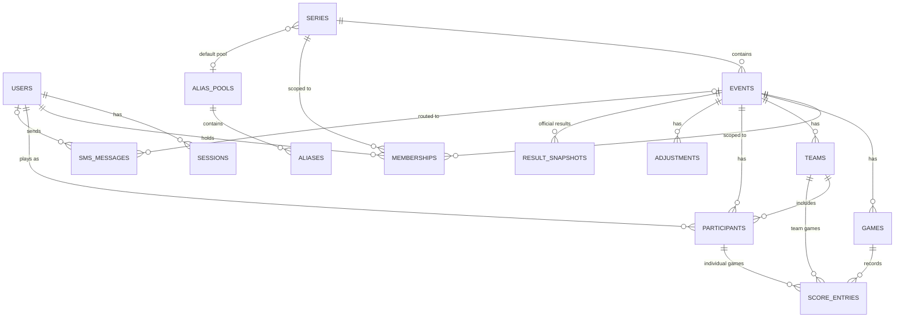

# Scorebot 9000: Modernization Plan

**Status:** Draft for review
**Based on:** `master` at `976d813` (Clinelympics 2021)
**Last updated:** 2026-11-20

---

## 1. Summary

Rebuild Scorebot 9000 as a **Rails 8 + Hotwire + Postgres** app on **Cloud Run**. Today it is a single-purpose Clinelympics site. The new version is a small event-hosting platform:

- **Platform → Series → Event → Game.** "Clinelympic Games" becomes a *series*. Each year's games become an *event* in that series, with its own homepage, rules, schedule, theme and results.
- **Relational schema.** Real foreign keys and constraints replace hand-joined Datastore entities.
- **Passwordless sign-in by phone or email.** Phone codes go through Twilio Verify, email codes through a mail provider. A phone and an email can belong to one account.
- **Twilio stays** for SMS scoring. Existing commands keep working, a few are added, and event routing works when more than one event is running.
- **A configurable scoring engine.** It has medal tables, weighted medals, placement points, averages, team aggregation and tie rules. It ships with a "Legacy Clinelympics" preset that is checked against all 10 historical events.
- **A fully new UI.** It is mobile-first, has live-updating results and a TV mode, and supports per-event theming.
- **One import, then a clean cutover.** A single data import from Datastore, redirects for old URLs, and a short runbook to switch Twilio and DNS.

---

## 2. What exists today

| Area | Current state |
|---|---|
| Runtime | App Engine standard, `java8` runtime, servlets + JSP scriptlets. About 5k lines. |
| UI | Bootstrap 2, jQuery `.live()`, Google Analytics `ga.js` (Universal Analytics, which is shut down) |
| Data | Cloud Datastore. There are 7 kinds, and every entity of a kind hangs off one hard-coded ancestor key (e.g. all events are children of `Events/eventList`). Relationships are integer/phone properties joined by hand in JSPs. |
| Auth | App Engine Users API. A single admin is identified by Google nickname, stored in a singleton `setting` entity. |
| SMS | Twilio webhook → `/inbound` → TwiML reply |
| Scoring | Copy-pasted across `summary.jsp`, `medals.jsp` and `scores.jsp` (about 300 lines each), plus `Medal.java` |
| Event content | Hard-coded in `index.jsp` and `details.jsp`: 2021 dates, game list, rules, past-results links. Every year needed a code change and a redeploy. |

### 2.1 Current data (Datastore kinds)

| Kind | Fields | Notes |
|---|---|---|
| `setting` | `adminName`, `adminNumName`, `eventID`, `siteName` | Singleton. `eventID` = "current event" (`-1` = none) |
| `event` | `eventID`, `eventName`, `medals` (CSV), `active`, `archived`, `teamscore`, `teams` | All 10 prod events: teams = yes, team scoring = yes |
| `game` | `eventID`, `gameID` (1..n per event), `gameName`, `scoreType` (true = high wins) | `gameID` is the number players text in `SCORE <id> <n>` |
| `player` | `eventID`, `playerID` (phone number, or free text when an admin added the player), `playerName` (random alias), `teamName` (UPPERCASED free text) | One row per person per event. Identity across years exists only through the phone number. |
| `score` | `eventID`, `playerID`, `gameID`, `playerScore` (int), `date` | Upserted: re-texting overwrites. Integers only. |
| `name` | `Name`, `rnd`, `isUsed` | Global pool of random aliases. `isUsed` is reset whenever an event is activated. |
| `text` | `SmsSid`, `AccountSid`, `From`, `Body`, `date` | Inbound SMS log (the admin "simulator" writes here too) |

### 2.2 Current scoring behavior (to reproduce for history)

Every production event used **team scoring**:

1. Each player has at most one integer score per game. The latest submission wins.
2. **A team's score for a game is the sum of its members' scores.** This is why the rules said "only one player per team submits for team games" and the readme says "teams must be the same size."
3. Per game, *distinct* team totals are ranked (higher or lower is better, set per game). The top 3 distinct values get Gold, Silver and Bronze. **Ties share a medal and do not use up a slot** (dense ranking: 10, 10, 8 → Gold, Gold, Silver).
4. Team points = Σ medal points, where points = (number of tiers − tier index): **Gold 3, Silver 2, Bronze 1.**
5. Standings sort by points, then golds, then silvers, then bronzes, then team name. The name tiebreak is *reverse* alphabetical, an accident of `Medal.compareTo`.

Individual-scored events (supported, but no prod event used them) rank players the same way. There, though, the total is an **unweighted** medal count, and team totals are the sum of members' unweighted counts. The two modes are inconsistent.

### 2.3 Problems to fix rather than port

**Security (relevant now, because production data is live):**
- `/add` (all admin writes and deletes) checks only a **client-supplied `userEmail` header** against the admin's nickname (`AddServlet.java:47`). Anyone who guesses the nickname can create, edit or delete events, players and scores.
- `/inbound` does **not validate Twilio's request signature**. Anyone can POST as any phone number, including the admin number that runs `ADMIN START/STOP`.

**Correctness:**
- The tie check in `Medal.addScore` uses `String.contains` on a comma-joined name list (`Medal.java:54`). A tied competitor whose name is a substring of another tied name (e.g. `BEAR` and `BEARS`) gets pushed down a medal slot. Names containing `", "` also break the medal-count split.
- Medal counts are keyed by player *alias*, not by ID (`medals.jsp:203`). Two players with the same alias merge.
- Alias assignment is not transactional and uses a global `isUsed` flag. It races, and concurrent events collide.
- `REGISTER` with no aliases left → `Random.nextInt(0)` throws (`InboundServlet.java:87`). `CHANGE` or `ADMIN` with no second word → `ArrayIndexOutOfBounds` (`:163`, `:256`). Re-registering silently does nothing.
- Integer-only scores: no times, decimals or placements.
- Admin score entry looks up the game without an event filter (`AddServlet.java:98`).
- `details.jsp` documents `CHANGE NAME <new name>`, but the code ignores the name and assigns a random one.

**Platform:**
- The `java8` App Engine runtime reached end of support in January 2024. Google has said it will block deployments of end-of-support runtimes, so the app may already be impossible to redeploy (check the current runtime lifecycle page). It also depends on legacy bundled services (Users API).
- If the Twilio number isn't A2P 10DLC registered, US carriers now block its outgoing replies (see §8.5).

---

## 3. Goals and non-goals

**Goals**
1. Turn the app into a generic event platform: a platform homepage, series pages and event homepages, with all content editable in the app and nothing hard-coded.
2. Sign in with a phone number *or* an email, and link legacy phone-only players to emails.
3. Keep Twilio SMS scoring, backward compatible with existing muscle memory (`REGISTER`, `SCORE 1 228`, ...).
4. Use a relational data model with enforced integrity.
5. Make scoring configurable, with averages, placement points, team aggregation options, decimal and time scores, and frozen official results.
6. Build a new, mobile-first UI with live results.
7. Migrate all 10 historical events with results that match what was shown at the time.
8. Keep running costs near zero between events.

**Non-goals (for now)**
- Payments and ticketing, public self-serve signup at scale, native apps.
- Brackets as a first-class feature. Bracket games record final placements as scores (§7.4).

---

## 4. Recommended stack

**Recommendation: Rails 8 (Hotwire, Postgres), deployed to Cloud Run.**

| Concern | Rails 8 choice | Why it fits this app |
|---|---|---|
| Web framework | Rails 8.x, current Ruby | The app is mostly admin forms and CRUD, which is where Rails is strongest |
| Frontend | Hotwire (Turbo + Stimulus), importmap, `tailwindcss-rails` | Server-rendered and fast on phones, with no JS build pipeline |
| Live updates | Turbo 8 morphing page refreshes, broadcast over Action Cable via **Solid Cable** | Live scoreboard with no Redis |
| Background jobs | **Solid Queue**, run in-process with Puma | Low volume (emails, SMS broadcasts), so no separate worker |
| Database | Postgres | The data is relational. Constraints, partial unique indexes and JSONB for scoring config. |
| Auth | Rails 8 authentication generator (sessions), extended for passwordless OTP | Built in and small, with no Devise needed |
| Authorization | Action Policy (or Pundit) | Per-event and per-series organizer roles |
| SMS | `twilio-ruby`, `Rack::TwilioWebhookAuthentication`, Twilio Verify | Signature validation is one line of middleware |
| Phones | `phonelib` (libphonenumber) | E.164 normalization for login and legacy data |
| Rich content | Action Text (event descriptions, rules), Active Storage → GCS (logos, hero images) | Organizers edit content in the app |
| PII | Active Record Encryption (deterministic) on phone and email | Still queryable and uniquely indexed |
| Tests | Minitest, system tests, golden-master tests for scoring | |

**JavaScript alternative, if you'd rather:** Next.js (App Router), Postgres via Drizzle, Better Auth (it has phone and email OTP plugins), and the Twilio Node SDK, on Cloud Run or Vercel. It's a fine choice, but you'd assemble more yourself: admin CRUD, background jobs and realtime. Realtime on serverless usually needs a hosted service such as Ably or Pusher, or SSE. Everything below (data model, scoring engine, SMS design, phases) carries over unchanged. The scoring engine is pure functions either way.

---

## 5. Domain model

### 5.1 Concepts

- **User**: one human, with optional `email` and optional `phone` (at least one), and an optional platform-admin flag.
- **Series**: a recurring event brand ("Clinelympic Games"). It has a homepage, branding, the list of editions, and all-time stats.
- **Event**: one occurrence, e.g. "2021 Clinelympic Games". It may belong to a series or stand alone. It has a homepage, schedule, rules, team settings, scoring config, an SMS code and a lifecycle status.
- **Game**: one competition inside an event, e.g. "Trivia". Its `position` is the number players text.
- **Team**: belongs to an event.
- **Participant**: a user's registration in an event, with an alias and an optional team.
- **Score entry**: one submitted score for a game, by a participant (individual games) or a team (team games). Entries are append-only.
- **Adjustment**: a manual points bonus or penalty with a reason ("best uniforms +1").
- **Result snapshot**: the frozen official standings for a finished event.
- **Membership**: a role (owner, organizer or scorekeeper) for a user on a series or an event.
- **Alias pool / alias**: the random fun names, now in pools (a platform default plus per-series pools).
- **SMS message**: an inbound or outbound log entry, routed to a user and an event.

### 5.2 ERD



### 5.3 Tables (key columns and constraints)

**users**: `name`, `email` (normalized lowercase, encrypted deterministic, unique, nullable), `phone` (E.164, encrypted deterministic, unique, nullable), `email_verified_at`, `phone_verified_at`, `platform_admin` (bool), `sms_context_event_id` (last event chosen over SMS), `legacy_admin_nickname`. CHECK (email or phone present).

**sessions**: from the Rails 8 generator (`user_id`, `ip_address`, `user_agent`).

**sign_in_codes**: email OTP only (SMS OTP is handled by Twilio Verify). Columns: `email`, `code_digest`, `expires_at`, `attempts`, `consumed_at`.

**series**: `slug` (unique), `name`, `tagline`, Action Text `description`, `logo`/`hero` (Active Storage), `theme` (jsonb: accent color, etc.), `default_alias_pool_id`.

**events**:
- `series_id` (nullable), `slug` (unique), `name`, `edition_label` (e.g. "2021")
- `starts_at`, `ends_at`, `time_zone`, `location_text`, `online_url`
- Action Text `description`, `rules`, `schedule`
- `status` enum: `draft → published → live → final → archived`. This replaces `active`, `archived` and the global "current event".
- `registration_open` (bool), `sms_code` (unique, e.g. `CLINE27`)
- `team_mode` enum: `none | self_registered | assigned`; `max_team_size`
- `scoring` (jsonb, validated by `Scoring::Config`, §7)
- `alias_pool_id`, `theme` (jsonb), `legacy_event_id` (unique, nullable)

**games**:
- `event_id`, `position` (unique per event; the SMS number), `name`, Action Text `description`, `scheduled_at`
- `direction` enum: `higher_better | lower_better`
- `score_format` enum: `integer | decimal | time | placement`
- `participation` enum: `individual | team` (who submits: each player, or one score per team)
- `team_aggregation` enum: `sum | average | best | top_n_sum | median`, plus `team_aggregation_n`. Applies only when an individual game rolls up to team standings.
- `attempt_policy` enum: `latest | best | average`
- `weight` (decimal, default 1.0), `status` enum: `upcoming | open | locked | final`
- `legacy_game_id`

**teams**: `event_id`, `name`, `color`, `emoji`. Unique index on (`event_id`, `lower(name)`).

**participants**: `event_id`, `user_id`, `team_id` (nullable), `alias`, `registered_via` enum (`sms | web | organizer | import`). Unique on (`event_id`, `user_id`) and (`event_id`, `lower(alias)`). Uniqueness lives in the DB, so the old `isUsed` flag goes away.

**score_entries**:
- `game_id`, `participant_id` (nullable), `team_id` (nullable), `value` (`numeric(14,3)`), `raw_input` (what was typed)
- `source` enum (`sms | web | organizer | import`), `submitted_by_user_id`, `voided_at`, `voided_by_user_id`, `created_at`
- CHECK exactly one of `participant_id` / `team_id`
- Append-only, so history comes for free. The game's `attempt_policy` picks the effective value. "Undo" and admin delete set `voided_at`.

**adjustments**: `event_id`, `participant_id` or `team_id`, `points` (decimal), `reason`, `created_by_user_id`.

**result_snapshots**: `event_id`, `computed_at`, `scoring_config` (jsonb copy), `standings` (jsonb), `game_results` (jsonb), `official` (bool). Finalizing an event writes an official snapshot. **Finished events always render from their snapshot**, so later engine changes never rewrite history.

**memberships**: `user_id`, `resource_type`/`resource_id` (Series or Event), `role` enum `owner | organizer | scorekeeper`.

**alias_pools** / **aliases**: `alias_pools(name, owner)`, `aliases(alias_pool_id, name)`. Unique (`pool`, `lower(name)`).

**sms_messages**: `direction` (`inbound | outbound`), `twilio_sid` (unique; idempotent webhook handling), `from`, `to`, `body`, `user_id`, `event_id`, `command`, `status`, `error`, `legacy` (bool), `created_at`.

---

## 6. Identity and sign-in

### 6.1 Sign-in flow (phone or email)

1. A single field: **"Email or mobile number"**.
2. If the input contains `@`, treat it as an email. Otherwise parse it with `phonelib` (default region US) into E.164.
3. Send a 6-digit code:
   - **Phone:** Twilio Verify. It handles code generation, delivery, retries, rate limits and SMS-pumping fraud protection. Verify sends from Twilio's own registered senders, so login works whatever your number's 10DLC status. It costs about $0.05 per successful verification.
   - **Email:** Action Mailer sends a code plus a one-click magic link, through Postmark, Resend or SendGrid.
4. After verification, find or create the user by that identifier and start a session. Sign-up and sign-in are the same flow.
5. Throttling: Rails 8 `rate_limit` on the request and verify endpoints, plus Verify's built-in limits.

### 6.2 Linking legacy phones to emails

Legacy players exist only as phone numbers. There are three ways to attach emails:

- **Self-serve:** sign in with your phone, then go to Account → "Add email". Verifying the code attaches the email, and from then on you can sign in with either.
- **Organizer bulk map:** upload a `phone,email` CSV in the admin console. Each email is stored as *pending* on the matching phone-based user. The first time that person signs in with the email code, it is verified and linked. Signing in with a code already proves ownership.
- **Merge:** if someone ends up with two accounts (one by phone, one by email), verifying both identifiers in one session merges them. Participations, memberships and score attribution move to one user.

Texting the event number creates or uses a phone-only user automatically, so SMS-only players never need the web. Web sign-in always requires a code.

### 6.3 Roles

- **Platform admin** (you): everything.
- **Series owner/organizer**: manages the series and all its events.
- **Event organizer**: manages one event.
- **Scorekeeper**: can enter and void scores only. Useful for a helper at the party.
- **Participant**: registers, picks a team, submits their own (or their team's) scores if the game allows it.

SMS `ADMIN` commands are authorized by role on the routed event. They are no longer tied to a single phone in a settings row.

---

## 7. Scoring engine

### 7.1 Design

`Scoring::Engine` is **pure Ruby with no database access**. It takes plain data and returns standings, which makes it fast, easy to test exhaustively, and identical between live computation and snapshots.

```ruby
result = Scoring::Engine.new(Scoring::Config.from(event.scoring)).call(
  games:       [...],  # direction, participation, team_aggregation, attempt_policy, weight, score_format
  competitors: [...],  # participants (with team_id) and teams
  entries:     [...],  # non-voided score entries
  adjustments: [...]
)
result.standings     # ordered rows: competitor, place, medal counts, points, tiebreak values
result.game_results  # per game: ranked rows (place, medal, effective value) and stats (n, mean, median, best)
```

### 7.2 Pipeline

1. **Effective score** per (game, competitor), using the game's `attempt_policy`: `latest` (legacy), `best` or `average`.
2. **Team rollup.** For individual-participation games when standings are team-based, aggregate member scores with `team_aggregation`:
   - `sum` (legacy), `average` (fixes uneven team sizes), `best`, `top_n_sum`, `median`
   - plus a missing-member policy: `ignore | count_as_zero`
3. **Rank each game** by direction. Two tie modes:
   - `competition`: 1, 2, 2, 4. Standard, and the new default.
   - `dense`: 1, 2, 2, 3. Legacy, where ties don't use up medal slots.
4. **Award** per game, multiplied by the game's `weight`:
   - medals for the top N places (tiers configurable)
   - and/or placement points (e.g. `[10, 8, 6, 5, 4, 3, 2, 1]`, or "N − place + 1", so every place counts)
   - and/or a normalized score of 0–100 relative to the best and worst value, so games on different scales can be averaged
5. **Standings method** (one per event):

   | Method | Description |
   |---|---|
   | `medal_table` | Olympic style: most golds, then silvers, then bronzes |
   | `weighted_medals` | Sum of medal points (legacy team mode: 3/2/1) |
   | `medal_count` | Total medals, unweighted (legacy individual mode) |
   | `placement_points` | Sum of placement points across games |
   | `average_rank` | Mean place across games, with a minimum-games-played rule and a penalty place for skipped games |
   | `normalized_average` | Mean of normalized 0–100 game scores |

6. **Adjustments** are added after the standings method, and are shown openly in the UI.
7. **Tiebreakers**: an ordered list, e.g. `[golds, silvers, bronzes, best_single_place, name]`.

### 7.3 Config shape (`events.scoring` JSONB)

```yaml
basis: team                 # team | individual: who the main standings rank
ranking: competition        # competition | dense
medals:
  - { name: Gold,   points: 3, color: "#D4AF37" }
  - { name: Silver, points: 2, color: "#A8A9AD" }
  - { name: Bronze, points: 1, color: "#CD7F32" }
standings: weighted_medals  # see table above
placement_points: [10, 8, 6, 5, 4, 3, 2, 1]
missing_scores: ignore      # ignore | worst_place | zero
tiebreakers: [golds, silvers, bronzes, name]
show_individual_standings: true
```

**Presets** in the organizer UI: "Olympic medal table", "Weighted medals", "Placement points", "Average rank", and **"Legacy Clinelympics (2012–2021)"**. The legacy preset is `basis: team`, `ranking: dense`, 3/2/1 medals, `weighted_medals`, games `individual` + `sum` + `latest`, and a reverse-alphabetical final tiebreak. It exists so the import reproduces history exactly.

### 7.4 Score formats

- `integer`, `decimal`
- `time`: accepts `1:23.45` or `83.45`, stores seconds, and displays as `m:ss.ss`
- `placement`: the organizer enters the final place directly (1, 2, 3...), with lower being better. This covers bracket games such as 2021's "Bracketeering" without building a bracket UI.
- Later idea: a `votes` format with in-app voting, replacing the external "vote here" link used for Contemporary Art.

### 7.5 Verification

- **Unit tests** for each stage and option, including tie edge cases, empty games, uneven teams and voided entries.
- **Golden-master tests**: for each of the 10 legacy events, the legacy preset must reproduce the medal tables and standings as the old site displayed them (§10.3).
- **Property tests** (optional): permuting input order never changes results.

---

## 8. SMS (Twilio)

### 8.1 Inbound flow

```
Twilio ──POST──▶ /twilio/sms   (old /inbound kept as an alias during cutover)
  1. Rack::TwilioWebhookAuthentication validates X-Twilio-Signature (403 if invalid)
  2. Insert sms_messages row (unique on MessageSid, so Twilio retries are no-ops)
  3. Resolve the user by From (create a phone-only user if new)
  4. Resolve the event (8.2)
  5. Sms::CommandParser → command object
  6. Run it through the same service objects the web UI uses
     (Participants::Register, Scores::Submit, Teams::Change, ...)
  7. Reply with TwiML (Twilio::TwiML::MessagingResponse) and log the outbound row
```

### 8.2 Event routing (needed once more than one event can be live)

1. Explicit: `JOIN <code>` sets the sender's SMS context to that event.
2. Otherwise, if the sender is a participant in exactly one **live** event, use it.
3. Otherwise, if the receiving number (`To`) is assigned to an event, use it.
4. Otherwise, if exactly one live event accepts SMS, use it. This is the common case and matches today's behavior.
5. Otherwise, reply: "Which event? Text JOIN followed by the event code."

### 8.3 Commands

Existing commands keep working unchanged.

| Command | Behavior |
|---|---|
| `REGISTER [team]` | Join the routed event (with a team if the event uses self-registered teams) and get an alias. Re-registering replies with your current info instead of staying silent. |
| `JOIN <code> [team]` | Same, for an explicitly chosen event |
| `SCORE <game#> <value>` | Submit a score. The value may be decimal or `m:ss`. Rejected if the game is locked. For team games, any member can submit for the team. |
| `UNDO` | Void your last submission |
| `WHO` / `ME` | Your alias, team and scores so far |
| `GAMES` | Game numbers and names |
| `STANDINGS` | The top 3, plus your or your team's position |
| `CHANGE TEAM <name>` | Switch teams (if allowed) |
| `CHANGE NAME [name]` | New random alias, or a chosen name if the event allows it |
| `COMMANDS` / `?` | Command list (see the reserved-keyword note) |
| `ADMIN START\|STOP [code]`, `ADMIN LOCK <game#>` | Organizers only, authorized by role |

The parser is case-insensitive, tolerates extra whitespace, and replies with a helpful error rather than raising (fixes the crashes in §2.3).

### 8.4 Reserved keywords

`STOP`, `START`, `HELP`, `UNSUBSCRIBE` and similar words, sent as the whole message, are carrier opt-out keywords handled by Twilio. Configure **Advanced Opt-Out** on the Messaging Service so `HELP` returns the command list, and add `COMMANDS` / `?` as aliases. `ADMIN STOP` isn't affected because it isn't the whole message.

### 8.5 Compliance and numbers

- **A2P 10DLC:** US carriers block unregistered application traffic from 10-digit local numbers, and replies to players count as outbound traffic. Register a brand and campaign ("Sole Proprietor" if you have no EIN) and attach the 909 number to a Messaging Service, or move to a verified toll-free number. **Approval can take days to weeks, so start in Phase 0.**
- Use a **second, cheap Twilio number for staging** so end-to-end testing never touches production.
- Proactive outbound messages (e.g. "Results are final!" or "Game 3 starts in 10 min") go through the REST API from a job. Add these after launch, with opt-in wording that matches the 10DLC campaign.

---

## 9. Product and UI

### 9.1 Direction

- **Mobile-first.** Players use phones at the party. Big tap targets, and the first screen answers "how are we doing?".
- **A sports-broadcast feel:** large numerals, podiums, team colors, smooth live updates.
- **Two visual layers.** The platform has its own neutral Scorebot 9000 brand. Each series or event can set an accent color, logo and hero image, so Clinelympics keeps its flag and emblem look.
- Tailwind with a small component set (cards, tables, podium, stat tiles), dark mode and accessible tables.

### 9.2 Pages

**Public**

| Route | Page |
|---|---|
| `/` | Platform home: what Scorebot 9000 is, **Live now**, upcoming events, recent results, featured series, sign-in, "Host an event" |
| `/s/:series` | Series home (e.g. `/s/clinelympics`): branding, editions timeline, champions by year, all-time medal table by person, records per recurring game (e.g. best Trivia score ever) |
| `/e/:event` | Event home (e.g. `/e/clinelympics-2021`): hero, date, time and location, description, schedule, rules, games with their numbers, an auto-generated **"How to play by text"** block (number, code, examples), a register CTA and a live standings widget |
| `/e/:event/results` | Live standings: podium, full table, toggle between team and individual, per-game medal grid |
| `/e/:event/games/:n` | Game detail: ranked scores, medals, stats (mean, median, best) |
| `/e/:event/teams/:id` | Team page: members, per-game scores, medals |
| `/e/:event/tv` | **TV mode** for a living-room screen: rotating standings, latest scores ticker, auto-refresh |

**Participant (signed in):** `/me` (my events, history, account and linked identifiers), `/e/:event/join`, and score submission from the event page (mirrors SMS).

**Organizer console (`/manage`):**
- Event setup wizard: basics → content → teams → games → scoring preset (with a preview against sample data) → SMS code → publish
- Games builder with drag-to-reorder; renumbering is blocked once the event is live
- Teams: create, rename, recolor, **randomize or balance teams** (e.g. "teams of 2, one team of 3 if odd"), and drag players between teams
- Participants: add manually, set aliases, merge duplicates, bulk-map phone → email
- **Score grid**: spreadsheet-style keyboard entry (game × competitor), void with audit trail
- Adjustments, lifecycle controls (Publish, Open registration, Go live, Lock game, **Finalize**, Archive)
- SMS log and **SMS simulator**, a successor to today's Texts tab and useful for rehearsing
- Alias pools, co-organizers and scorekeepers, series settings

### 9.3 Legacy URL redirects (handled by Rails routes)

| Old | New |
|---|---|
| `/` , `/index.jsp` | `/` |
| `/summary.jsp?e=N`, `/medals.jsp?e=N`, `/scores.jsp?e=N` | `/e/<slug of legacy N>/results` (and the matching tab) |
| `/summary.jsp`, `/medals.jsp`, `/scores.jsp` (no `e`) | the current or most recent Clinelympics event |
| `/details.jsp` | the latest Clinelympics event home |
| `/admin.jsp` | `/manage` |
| `/inbound` | `/twilio/sms` (kept until the Twilio config is switched) |

If the old site lives on an `*.appspot.com` URL rather than a custom domain, the new app can't take over that hostname from Cloud Run. In that case, deploy a tiny redirect service (about 20 lines, on a current App Engine standard runtime such as Node or Python) that returns 301s for the paths above to the new domain.

---

## 10. Data migration

### 10.1 Export (Phase 0, before anything else)

1. **Backup of record:** `gcloud datastore export gs://<bucket>/scorebot-legacy-<date> --project=<project>`. This is a managed export. It can be restored, or loaded into BigQuery for inspection (`bq load --source_format=DATASTORE_BACKUP`).
2. **Working dump:** `bin/rails legacy:dump` uses the `google-cloud-datastore` gem to query each kind under its ancestor key and write `<kind>.jsonl`. It goes to a **private GCS bucket, not git**, because it contains phone numbers. All later imports read from this dump, never from production.

### 10.2 Import (`bin/rails legacy:import DIR=...`)

The import is idempotent: it upserts on legacy IDs, runs in one transaction, and can be re-run freely in development and staging.

| Legacy | New |
|---|---|
| `setting` | Platform-admin `User` (email from the admin nickname, to be confirmed), with `adminNumName` attached as that user's phone. `siteName` is dropped (the platform is "Scorebot 9000"). `eventID` is dropped (replaced by status). |
| `event` | A `Series` "Clinelympic Games" (`/s/clinelympics`) plus one `Event` per row: slug `clinelympics-<year>`, `status: final` (or `archived` if archived), `legacy_event_id`, medal tiers from the CSV with points N..1, `team_mode` from `teams`, and the legacy scoring preset (team or individual basis from `teamscore`). **Event dates aren't stored in legacy data**, so derive `starts_at` from the earliest score or text date per event, then let you correct it. |
| `game` | `Game` with `position = gameID`, `direction` from `scoreType`, `participation: individual`, `team_aggregation: sum`, `attempt_policy: latest`, `score_format: integer` |
| `player` | `User` deduplicated by normalized phone **across all events**, so people link across years. `Team` is find-or-create by (event, upper(name)), with the display name title-cased. `Participant` gets `alias = playerName`. |
| `score` | `ScoreEntry` (`source: import`, `created_at = date`). Participant is found by (event, phone), game by (event, gameID). Duplicates keep the latest entry; orphans are reported and skipped. |
| `name` | Alias pool "Clinelympics Classics", set as the series default. `isUsed` and `rnd` are dropped. |
| `text` | `sms_messages` (`legacy: true`), linked to users by phone. Optional, see open questions. |

**Data hygiene the importer must handle:**
- `playerID` values that aren't valid phone numbers. The admin forms and simulator allowed free text of up to 10–15 characters. Map these to placeholder users with no phone and flag them in the report.
- Team names that differ only in case or spacing, which should be merged per event.
- Multiple `setting` rows, or duplicate events, games or players (the code logs "Multiple ..." warnings, so these probably exist).

### 10.3 Validation

1. **Count reconciliation report:** each legacy kind compared with imported rows, plus orphans, invalid phones and merged duplicates.
2. **Golden results.** Before the old site goes away, scrape `/summary.jsp?e=1..10` (plus `medals.jsp` and `scores.jsp`) and parse the tables into `test/fixtures/legacy_results/event_N.json`. These pages show only aliases and team names, never phone numbers, so they are safe to commit. A test then asserts the engine's legacy preset reproduces every table.
3. **Diffs.** Any difference is investigated. A known legacy bug (e.g. the substring tie issue in §2.3) could mean the old site *displayed* a result that a correct computation wouldn't. In that case, the official snapshot stores what was announced (pending your call, see open questions).
4. **Freeze.** Each imported event gets an official `result_snapshot`.

If the old site no longer serves pages, fall back to running the legacy `Medal` algorithm (ported verbatim into a test helper) against the dump.

---

## 11. Hosting, deployment and operations

- **Compute:** Cloud Run service built from the Rails 8 Dockerfile. `min-instances=0` normally, and `1` on event day to avoid cold starts mid-party (one `gcloud run services update` command, or a scheduled toggle). Solid Queue runs inside Puma. Use instance-based (always-allocated CPU) billing only while an event is live.
- **Database:** **Neon** Postgres (free tier, scales to zero) is the cheapest fit for once-a-year traffic. If you want everything inside GCP, **Cloud SQL for Postgres** works too, but its smallest instance is billed around the clock (roughly $10+ a month).
- **Files:** Active Storage on a GCS bucket.
- **Secrets:** Secret Manager → env vars (`RAILS_MASTER_KEY`, `DATABASE_URL`, Twilio SID, token and Verify service SID, mail API key).
- **CI/CD:** GitHub Actions runs tests, RuboCop and Brakeman, builds the image, pushes it to Artifact Registry, runs migrations as a Cloud Run Job, then deploys. It authenticates with Workload Identity Federation, so there are no JSON keys.
- **Domain:** Cloud Run domain mapping where the region supports it, otherwise a load balancer. Confirm WebSocket behavior through whichever front door is chosen. Live updates fall back to 15-second polling-driven Turbo refreshes if WebSockets aren't available.
- **Observability:** structured logs to Cloud Logging, an uptime check on Rails `/up`, error tracking (Sentry free tier or Google Error Reporting), and Twilio Debugger alerts by email.
- **Backups:** Neon point-in-time restore or Cloud SQL automated backups, plus a `pg_dump` to GCS after each event is finalized.
- **Expected idle cost:** close to $0 for compute and database, plus the Twilio number and 10DLC campaign fees (a few dollars a month) and about $0.05 per phone login.

---

## 12. Phased roadmap

| # | Phase | Size | Deliverables | Exit criteria |
|---|---|---|---|---|
| 0 | **Safeguard and prep** | S | Datastore export and JSONL dump; scrape golden results; Twilio audit and **start 10DLC registration**; answer open questions; then consider **disabling the legacy App Engine app** (App Engine → Settings → Disable, which is reversible) because its admin endpoint is effectively open | Backup in GCS, golden fixtures captured, registration submitted |
| 1 | Foundation | S | Move the Java app to `legacy/`; `rails new` at the repo root (Postgres, Tailwind, importmap); CI; Dockerfile; staging on Cloud Run with Neon | CI deploys to a staging URL |
| 2 | Schema and importer | M | Migrations, models, constraints, `legacy:dump` and `legacy:import`, reconciliation report | All 10 events imported on staging; counts reconcile; anomalies listed |
| 3 | Scoring engine | M | `Scoring::Engine`, config and presets, result snapshots, unit and golden tests | Golden tests pass for all 10 events, or diffs are explained and accepted |
| 4 | Public site | M | Platform home, series page, event home, results, game and team pages, theming, legacy redirects | Historical Clinelympics browsable on staging in the new design |
| 5 | Accounts | M | Phone/email OTP, sessions, add-identifier and merge, roles and policies, phone→email CSV mapping | You can sign in by phone or email; a legacy player can claim their history |
| 6 | SMS | M | Webhook with signature validation, parser, routing, commands, TwiML, logging, simulator | A real phone completes REGISTER → SCORE → STANDINGS against the staging number |
| 7 | Organizer console | L | Wizard, games builder, teams (randomize and balance), score grid, adjustments, lifecycle, SMS log, co-organizers | You can set up a full event without touching code |
| 8 | Live experience | S–M | Turbo broadcast refreshes, TV mode, podium and score animations | A score submitted by SMS appears on an open results page and TV mode within seconds |
| 9 | **Cutover** | S | §13 runbook | Production on the new stack; Twilio and DNS switched; legacy disabled |
| 10 | Platform extras | later | Invite-based organizer signup, all-time person profiles, proactive SMS broadcasts, CSV import/export, in-app voting games | — |

**MVP cut line** (if a Clinelympics is coming up soon): Phases 0–6, the core of Phase 7 (event, games, teams, score grid, lifecycle, simulator), live refresh and TV mode from Phase 8, then the cutover. Everything else follows after the event.

**Repo layout during the migration:**

```
/           Rails app (app/, config/, db/, test/, ...)
/legacy/    current Java app, read-only reference; deleted after cutover (tag legacy-java-final first)
/docs/      this plan and short ADRs for decisions made along the way
```

---

## 13. Cutover runbook

1. Make sure no event is live. Announce a short maintenance window if anyone might be texting.
2. Take a final Datastore export and dump, run `legacy:import` against **production** Postgres, and review the reconciliation report and golden tests.
3. Point the domain at Cloud Run (or deploy the appspot redirector, §9.3), and verify TLS and the legacy redirects.
4. In Twilio, point the number's or Messaging Service's incoming-message webhook at `https://<domain>/twilio/sms`.
5. Smoke test: simulator, then a real phone (`COMMANDS`, `REGISTER`, `SCORE`, `UNDO`) on a throwaway draft event; confirm the signature check rejects an unsigned POST; sign in with your phone and with your email.
6. Disable (don't delete) the legacy App Engine app. Keep the Datastore export in GCS (Archive storage class).
7. After a few weeks of stability: delete `legacy/` from the repo (it stays in git history and the tag), remove the `/inbound` alias, and optionally delete the old App Engine versions.

---

## 14. Risks

| Risk | Impact | Mitigation |
|---|---|---|
| Next event date arrives before the MVP is ready | High | Hold to the MVP cut line. The legacy app can't be relied on as a fallback, given the runtime status. |
| 10DLC registration delay or rejection | High: SMS replies blocked | Start in Phase 0. A verified toll-free number is the fallback. Web scoring works regardless. |
| Legacy prod data tampered with via the open `/add` endpoint before export | Medium | Export first (Phase 0, step 1), then disable the legacy app |
| Historical results don't reproduce exactly | Medium | Golden fixtures plus snapshots of what was announced; differences are documented |
| Dirty legacy data (bad phones, orphans, duplicates) | Low–Medium | Importer report, placeholder users, re-runnable import |
| WebSockets through the chosen front door | Low | Polling-driven Turbo refresh fallback |
| Cold starts during the event | Low | `min-instances=1` on event day |

---

## 15. Open questions

1. **Timeline:** When is the next event you need this for? This sets the MVP cut line. Also, did any events happen in 2022–2026 that should be backfilled, e.g. from spreadsheets?
2. **Who hosts:** Is it just you (plus invited co-hosts), or should anyone be able to sign up and host? This plan builds multi-organizer roles but keeps signup invite-only at first.
3. **Stack:** Are you OK with Rails 8 + Hotwire (recommended), or would you prefer the Next.js variant?
4. **Hosting:** Should this stay on GCP (Cloud Run)? For the database, Neon (cheapest) or Cloud SQL (all-GCP)? Any monthly budget ceiling?
5. **Current production:** What is the live URL (custom domain or `*.appspot.com`)? Does the app still serve today? What is the GCP project ID, and do you have owner access for the export?
6. **Twilio:** Is the 909 number still active? Is it 10DLC registered? Are you OK with Twilio Verify for login codes (about $0.05 each)?
7. **Historical results:** If recomputation ever differs from what the old site showed at the time, which should win? (Recommendation: what was shown and announced.)
8. **Aliases:** Keep random alias assignment as the default? Should players be able to choose their own name (the 2021 details page implied they could)?
9. **Old SMS logs:** Import them (they contain phone numbers and message bodies) or leave them only in the archived export?
10. **Admin identity:** Which email should the platform-admin account use? The legacy record stores only a Google nickname.
