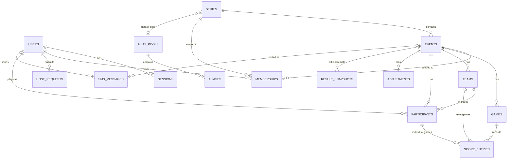

# Scorebot 9000: Modernization Plan

**Status:** Draft v2: revised with owner answers (cost-first hosting, gems, decisions in §2)
**Based on:** `master` at `976d813` (Clinelympics 2021)
**Last updated:** 2026-11-20

---

## 1. Summary

Rebuild Scorebot 9000 as a **Rails 8 + Hotwire** app on **SQLite**, running as **one small auto-suspending Fly.io machine**. Litestream backs the database up continuously to Cloudflare R2. Hosting costs a few dollars a month, and Twilio is the largest line item (§12).

The current single-purpose Clinelympics site becomes a small event-hosting platform:

- **Platform → Series → Event → Game.** The Scorebot 9000 homepage lists events and series. "Clinelympic Games" becomes a series, and **clinelympics.com becomes that series' custom domain**. Each year becomes an event with its own homepage, rules, schedule, theme and results.
- **Hosting.** Anyone can request to host. Hosting is gated behind approval for now, using Flipper.
- **Relational schema** with real foreign keys and constraints.
- **Passwordless sign-in by phone or email.** One account can have both.
- **Twilio stays** for SMS scoring. Existing commands keep working and a few are added.
- **Configurable scoring engine.** It has averages, placement points, team aggregation and tie rules. Finished events always show **what was announced**, stored as frozen snapshots.
- **Brand-new UI**: mobile-first, with live results and a TV mode.
- **Ops tooling** uses the gems you already know. **Flipper** handles gates and kill switches, **Blazer** handles production queries, and **Maintenance Tasks** runs imports and data fixes.
- **Staged rollout.** First move the historical archive to the new stack and shut down the insecure legacy app. Then build accounts, SMS and the organizer console. Then open hosting.

---

## 2. Decisions so far

| Topic | Decision |
|---|---|
| Stack | Rails 8 + Hotwire |
| Hosting | Any platform; **optimize for lowest running cost** |
| Timeline | No deadline; nothing to backfill beyond the 10 legacy events |
| Hosting access | Anyone can host eventually; gated approval list for now |
| Current prod | `clinelympics.com`, still live, GCP project `clinelympics`, owner has admin access |
| Twilio | Number still active; **not** A2P 10DLC registered |
| Historical results | **What was shown and announced wins.** Small score adjustments are acceptable to make the data agree. |
| Aliases | Random aliases are an *event setting*; players may override their alias |
| Legacy SMS logs | Import them |
| Platform admin | A Google-account email, added manually (not committed to the repo) |
| Ops gems | `flipper`, `blazer`, `maintenance_tasks` |

---

## 3. What exists today

| Area | Current state |
|---|---|
| Runtime | App Engine standard, `java8` runtime, servlets + JSP scriptlets. About 5k lines. |
| UI | Bootstrap 2, jQuery `.live()`, Google Analytics `ga.js` (Universal Analytics, which is shut down) |
| Data | Cloud Datastore. There are 7 kinds, and every entity of a kind hangs off one hard-coded ancestor key (e.g. all events are children of `Events/eventList`). Relationships are integer/phone properties joined by hand in JSPs. |
| Auth | App Engine Users API. A single admin is identified by Google nickname in a singleton `setting` entity. |
| SMS | Twilio webhook → `/inbound` → TwiML reply |
| Scoring | Copy-pasted across `summary.jsp`, `medals.jsp` and `scores.jsp` (about 300 lines each), plus `Medal.java` |
| Event content | Hard-coded in `index.jsp` and `details.jsp`: 2021 dates, game list, rules, past-results links |

### 3.1 Current data (Datastore kinds)

| Kind | Fields | Notes |
|---|---|---|
| `setting` | `adminName`, `adminNumName`, `eventID`, `siteName` | Singleton. `eventID` = "current event" (`-1` = none) |
| `event` | `eventID`, `eventName`, `medals` (CSV), `active`, `archived`, `teamscore`, `teams` | All 10 prod events: teams = yes, team scoring = yes |
| `game` | `eventID`, `gameID` (1..n per event), `gameName`, `scoreType` (true = high wins) | `gameID` is the number players text in `SCORE <id> <n>` |
| `player` | `eventID`, `playerID` (phone, or free text if an admin added the player), `playerName` (alias), `teamName` (UPPERCASED) | One row per person per event. Identity across years exists only through the phone number. |
| `score` | `eventID`, `playerID`, `gameID`, `playerScore` (int), `date` | Upserted: re-texting overwrites. Integers only. |
| `name` | `Name`, `rnd`, `isUsed` | Global alias pool. `isUsed` is reset when an event is activated. |
| `text` | `SmsSid`, `AccountSid`, `From`, `Body`, `date` | Inbound SMS log (the admin simulator writes here too) |

### 3.2 Current scoring behavior (to reproduce for history)

Every production event used **team scoring**:

1. Each player has at most one integer score per game. The latest submission wins.
2. **A team's score for a game is the sum of its members' scores.** This is why the rules said "only one player per team submits for team games" and why teams had to be the same size.
3. Per game, *distinct* team totals are ranked (higher or lower is better, set per game). The top 3 distinct values get Gold, Silver and Bronze. **Ties share a medal and don't use up a slot** (dense ranking: 10, 10, 8 → Gold, Gold, Silver).
4. Team points = Σ (number of tiers − tier index): **Gold 3, Silver 2, Bronze 1**.
5. Standings sort by points, then golds, then silvers, then bronzes, then team name. The name tiebreak is *reverse* alphabetical, an accident of `Medal.compareTo`.

Individual-scored events (supported, but unused in prod) total medals **unweighted**, which is inconsistent with team mode.

### 3.3 Problems to fix rather than port

**Security (relevant now, because the site is live):**
- `/add` (all admin writes and deletes) checks only a **client-supplied `userEmail` header** against the admin's nickname (`AddServlet.java:47`). Anyone who guesses it can create, edit or delete data.
- `/inbound` doesn't validate Twilio's signature. Anyone can POST as any phone number, including the admin number that runs `ADMIN START/STOP`.

**Correctness:**
- The tie check in `Medal.addScore` uses `String.contains` on a comma-joined name list (`Medal.java:54`). A tied competitor whose name is a substring of another (e.g. `BEAR` and `BEARS`) gets pushed down a medal. Names containing `", "` break the medal-count split.
- Medal counts are keyed by alias, not ID (`medals.jsp:203`), so duplicate aliases merge.
- Alias assignment isn't transactional and uses a global `isUsed` flag.
- `REGISTER` with no aliases left → `Random.nextInt(0)` throws (`InboundServlet.java:87`). `CHANGE` or `ADMIN` alone → `ArrayIndexOutOfBounds` (`:163`, `:256`). Re-registering silently does nothing.
- Integer-only scores. Admin score entry looks up the game without an event filter (`AddServlet.java:98`). `details.jsp` documents `CHANGE NAME <new name>`, but the code ignores the name.

**Platform:**
- The `java8` App Engine runtime reached end of support in January 2024, and Google has said it will block deploys of end-of-support runtimes. The app may already be impossible to redeploy.
- The Twilio number isn't 10DLC registered, so US carriers block its outgoing replies (§9.5).

---

## 4. Goals and non-goals

**Goals**
1. **Lowest practical running cost:** near $0 hosting while idle (which is most of the year), with no surprise bills.
2. A generic event platform: platform, series and event homepages, with all content editable in the app.
3. Sign in with phone or email, and link legacy phone-only players to emails.
4. Keep Twilio SMS scoring, backward compatible with `REGISTER`, `SCORE 1 228`, etc.
5. A relational data model with enforced integrity.
6. Configurable scoring (averages, placement points, team aggregation, decimal and time scores), with official results frozen as announced.
7. A new, mobile-first UI with live results.
8. Self-serve hosting for others, gated for now.

**Non-goals (for now):** payments and ticketing, native apps, a bracket builder (bracket games record final placements, §8.4), bring-your-own-Twilio for other hosts.

---

## 5. Recommended stack

| Concern | Choice | Why |
|---|---|---|
| Framework | Rails 8.x, current Ruby | Mostly forms and CRUD; you know it |
| Frontend | Hotwire (Turbo + Stimulus), importmap, `tailwindcss-rails` | Server-rendered, with no JS build pipeline |
| **Database** | **SQLite** (Rails 8 production defaults: separate DB files for primary, queue, cache and cable) | No database server to pay for. More than enough for this write volume. Rails 8 treats it as first-class for production. |
| Backups | `litestream` gem (Puma plugin) → Cloudflare R2 | Continuous replication, point-in-time restore, inside R2's free tier |
| Live updates | Turbo 8 morph refreshes broadcast over Action Cable via **Solid Cable** | Live scoreboard with no Redis |
| Jobs | **Solid Queue**, run in-process with Puma (`SOLID_QUEUE_IN_PUMA`), plus Mission Control – Jobs UI | One process, one machine |
| Auth | Rails 8 authentication generator, extended for passwordless OTP | Small and built in |
| Authorization | Action Policy (or Pundit), backed by a `memberships` table | Per-series and per-event roles |
| Feature gates | **Flipper** (Active Record adapter + Flipper UI) | Hosting approval, per-event SMS enablement, kill switches, rollouts (§7.4) |
| Prod queries | **Blazer** (read-only connection) | Ad-hoc SQL and canned reports (§12.5) |
| Imports and data fixes | **Maintenance Tasks** | Legacy import, CSV mappings, reconciliation, admin grants (§11) |
| SMS | `twilio-ruby`, `Rack::TwilioWebhookAuthentication`, Twilio Verify | Signature validation is one line of middleware |
| Phones | `phonelib` | E.164 normalization |
| Content and files | Action Text; Active Storage → R2 (S3-compatible, free egress) | Organizer-editable content |
| PII | Active Record Encryption (deterministic) for phone and email | Queryable and uniquely indexable; shows as ciphertext in Blazer by default |
| Email | Resend (free tier) or Amazon SES (pennies) | OTP codes and magic links |
| Tests | Minitest, system tests, golden-master scoring tests | |

The schema avoids database-specific features, so moving to Postgres later would just be a migration if growth ever calls for it.

---

## 6. Domain model

### 6.1 Concepts

- **User**: one human, with optional `email` and optional `phone` (at least one), and an optional platform-admin flag.
- **Series**: a recurring brand ("Clinelympic Games"). It has a homepage, branding, an optional **custom domain**, editions, and all-time stats.
- **Event**: one occurrence ("2021 Clinelympic Games"). It belongs to a series or stands alone. It has a homepage, schedule, rules, team settings, alias settings, scoring config, an SMS code and a lifecycle status.
- **Game**: a competition inside an event. Its `position` is the number players text.
- **Team**, **Participant** (a user's registration in an event: alias and team), and **Score entry** (append-only).
- **Adjustment**: manual points with a reason.
- **Result snapshot**: frozen official standings.
- **Membership**: a role on a series or event.
- **Host request**: an application to host, reviewed by the platform admin.
- **Alias pool / alias**, and **SMS message** (inbound and outbound log).

### 6.2 ERD



### 6.3 Tables (key columns and constraints)

Conventions for SQLite: use JSON columns (stored as text) where flexible config is needed. Enforce case-insensitive uniqueness with a normalized `*_key` column plus a unique index. Use CHECK constraints via `add_check_constraint`.

**users**: `name`, `email` (normalized, encrypted deterministic, unique, nullable), `phone` (E.164, encrypted deterministic, unique, nullable), `pending_email` (set by organizer mapping until verified), `email_verified_at`, `phone_verified_at`, `platform_admin` (bool), `sms_context_event_id`, `legacy_admin_nickname`. CHECK (email or phone present).

**sessions**: from the Rails 8 generator.

**sign_in_codes**: email OTP only (phone OTP is handled by Twilio Verify). Columns: `email`, `code_digest`, `expires_at`, `attempts`, `consumed_at`.

**series**: `slug` (unique), `name`, `tagline`, Action Text `description`, `logo`/`hero` (Active Storage), `theme` (JSON: accent color, etc.), **`custom_domain`** (unique, nullable, e.g. `clinelympics.com`), `default_alias_pool_id`.

**events**:
- `series_id` (nullable), `slug` (unique), `name`, `edition_label` ("2021")
- `starts_at`, `ends_at`, `time_zone`, `location_text`, `online_url`
- Action Text `description`, `rules`, `schedule`
- `status` enum: `draft → published → live → final → archived`. This replaces `active`, `archived` and the global "current event".
- `registration_open`, `sms_code` (unique, e.g. `CLINE27`)
- `team_mode` enum: `none | self_registered | assigned`; `max_team_size`
- **`alias_mode`** enum: `random | self_chosen | real_name`; **`allow_alias_override`** (bool, default true)
- `scoring` (JSON, validated by `Scoring::Config`, §8), `alias_pool_id`, `theme` (JSON), `legacy_event_id` (unique, nullable)
- SMS availability is a Flipper gate on the event (§7.4), not a column

**games**:
- `event_id`, `position` (unique per event), `name`, Action Text `description`, `scheduled_at`
- `direction`: `higher_better | lower_better`
- `score_format`: `integer | decimal | time | placement`
- `participation`: `individual | team` (who submits)
- `team_aggregation`: `sum | average | best | top_n_sum | median`, plus `team_aggregation_n` (for individual games rolling up to team standings)
- `attempt_policy`: `latest | best | average`
- `weight` (default 1.0), `status`: `upcoming | open | locked | final`
- `legacy_game_id`

**teams**: `event_id`, `name`, `name_key` (unique per event), `color`, `emoji`.

**participants**: `event_id`, `user_id`, `team_id` (nullable), `alias`, `alias_key` (unique per event), `alias_source` (`random | chosen | real_name | import`), `registered_via` (`sms | web | organizer | import`). Unique (`event_id`, `user_id`). DB uniqueness replaces the old `isUsed` flag.

**score_entries**:
- `game_id`, `participant_id` or `team_id` (CHECK exactly one)
- **`value_thousandths`** (integer). Exact values on SQLite, with no float drift and correct ties; the model exposes `value` as `BigDecimal`.
- `raw_input`, `source` (`sms | web | organizer | import | reconciliation`), `note`, `submitted_by_user_id`, `voided_at`, `voided_by_user_id`, `created_at`
- Append-only. The game's `attempt_policy` picks the effective value. "Undo" and deletes set `voided_at`.

**adjustments**: `event_id`, `participant_id` or `team_id`, `points`, `reason`, `created_by_user_id`.

**result_snapshots**: `event_id`, `computed_at`, `scoring_config` (JSON), `standings` (JSON), `game_results` (JSON), `official` (bool), `source` (`computed | legacy_capture`). Snapshots reference competitors **by ID** (not just display names), so series all-time stats can aggregate them.

**memberships**: `user_id`, `resource_type`/`resource_id` (Series or Event), `role`: `owner | organizer | scorekeeper`.

**host_requests**: `user_id`, `message`, `status` (`pending | approved | declined`), `reviewed_by_user_id`, `reviewed_at`.

**alias_pools** / **aliases**: `alias_pools(name, owner_type, owner_id)`, `aliases(alias_pool_id, name, name_key)`.

**sms_messages**: `direction`, `twilio_sid` (unique, so webhook handling is idempotent), `from`, `to`, `body`, `user_id`, `event_id`, `command`, `status`, `error`, `legacy` (bool), `created_at`.

---

## 7. Identity, roles and hosting access

### 7.1 Sign-in (phone or email)

1. A single field: **"Email or mobile number"**. If it contains `@`, treat it as an email. Otherwise use `phonelib` (default US) to get E.164.
2. Send a 6-digit code:
   - **Phone:** Twilio Verify (about $0.05 per successful verification). It sends from Twilio's own registered senders, so it works whatever your number's 10DLC status. Its Fraud Guard blocks SMS-pumping attacks. On an open sign-in form, that attack is the real cost risk, not the per-code fee.
   - **Email:** Action Mailer sends a code plus a magic link via Resend or SES. This costs nothing at this volume, so the UI nudges toward email where both are on file.
3. On success, find or create the user and start a session. Sign-up and sign-in are the same flow.
4. Throttle with Rails 8 `rate_limit`, Verify's limits, and **Twilio Messaging geo permissions restricted to US/Canada**.

### 7.2 Linking legacy phones to emails

- **Self-serve:** sign in by phone, then go to Account → "Add email" and verify it.
- **Organizer mapping:** a Maintenance Task takes a CSV upload of `phone,email` and sets `pending_email` on the matching users. Their first email sign-in verifies it and links it.
- **Merge:** if someone ends up with a phone account and an email account, verifying both in one session merges them. There is also an admin-side merge task.
- Texting the event number creates or uses a phone-only user. Web sign-in always requires a code.

### 7.3 Roles

| Role | Scope | Can |
|---|---|---|
| Platform admin | everything | Everything, including `/admin` (Flipper, Blazer, Maintenance Tasks, Mission Control, host requests) |
| Owner / organizer | series or event | Manage content, games, teams, participants, scores and lifecycle |
| Scorekeeper | event | Enter and void scores only |
| Participant | event | Register, pick a team, set an alias (if allowed), submit own or team scores (if allowed) |

You become the platform admin by running a one-time Maintenance Task (`Users::GrantPlatformAdminTask`, which takes an email parameter). The email never lands in the repo. Before accounts exist (Milestone A), `/admin` is protected with HTTP basic auth from Rails credentials.

### 7.4 Flipper usage

Flipper is for **gates, kill switches and rollouts**. Per-resource permissions ("organizer of event X") live in `memberships` with Action Policy, because Flipper isn't built for per-record authorization.

| Flag | Actor(s) | Purpose |
|---|---|---|
| `hosting` | user; group `platform_admins` | Can create series and events. Approving a host request enables this flag for that user. |
| `sms_scoring` | event | SMS commands accepted for this event. Platform-admin controlled, because texts cost money on *your* Twilio account. |
| `sms_inbound` | global | Kill switch: stop processing inbound SMS |
| `phone_login` | global | Kill switch: fall back to email-only sign-in if Verify spend spikes |
| `tv_mode`, `scoring_methods_v2`, `sms_broadcasts` | global or user | Staged rollout of new features |

Groups are registered from model state, e.g. `Flipper.register(:platform_admins) { |actor| actor.respond_to?(:platform_admin?) && actor.platform_admin? }`.

### 7.5 Gated hosting flow

1. A signed-in user clicks **"Host an event"**. Without `hosting`, they see a short request form (creates a `host_request`).
2. You get an email and a row in `/admin/host_requests`. Approve or decline.
3. Approving enables `hosting` for that user, and they can create series and events. Their events are **web-scoring only** unless you enable `sms_scoring` for the event.
4. Later, "open the gate" by enabling `hosting` for everyone. Before doing that, add per-event SMS caps and basic abuse controls (Milestone C).

---

## 8. Scoring engine

### 8.1 Design

`Scoring::Engine` is **pure Ruby with no database access**. It takes plain data and returns standings, so it's fast, easy to test exhaustively, and identical between live views and snapshots.

```ruby
result = Scoring::Engine.new(Scoring::Config.from(event.scoring)).call(
  games:       [...],  # direction, participation, team_aggregation, attempt_policy, weight, score_format
  competitors: [...],  # participants (with team_id) and teams
  entries:     [...],  # non-voided score entries
  adjustments: [...]
)
result.standings     # ordered rows: competitor, place, medal counts, points, tiebreak values
result.game_results  # per game: ranked rows (place, medal, effective value) and stats (n, mean, median, best)
```

### 8.2 Pipeline

1. **Effective score** per (game, competitor), using `attempt_policy`: `latest` (legacy), `best` or `average`.
2. **Team rollup** for individual games when standings are team-based. Options: `sum` (legacy), `average` (fixes uneven teams), `best`, `top_n_sum`, `median`, plus a missing-member policy (`ignore | count_as_zero`).
3. **Rank each game** by direction. Tie modes: `competition` (1, 2, 2, 4; the default) or `dense` (1, 2, 2, 3; legacy).
4. **Award** per game, multiplied by the game's `weight`: medals for the top N places, and/or placement points (e.g. `[10, 8, 6, 5, 4, 3, 2, 1]` or "N − place + 1"), and/or a normalized 0–100 score relative to the best and worst value.
5. **Standings method**:

   | Method | Description |
   |---|---|
   | `medal_table` | Olympic style: golds, then silvers, then bronzes |
   | `weighted_medals` | Sum of medal points (legacy team mode: 3/2/1) |
   | `medal_count` | Total medals (legacy individual mode) |
   | `placement_points` | Sum of placement points |
   | `average_rank` | Mean place across games, with a minimum-games rule and a penalty place for skipped games |
   | `normalized_average` | Mean of normalized 0–100 game scores |

6. **Adjustments** are added afterward and shown openly.
7. **Tiebreakers**: an ordered list, e.g. `[golds, silvers, bronzes, best_single_place, name]`.

### 8.3 Config (`events.scoring` JSON)

```yaml
basis: team                 # team | individual
ranking: competition        # competition | dense
medals:
  - { name: Gold,   points: 3, color: "#D4AF37" }
  - { name: Silver, points: 2, color: "#A8A9AD" }
  - { name: Bronze, points: 1, color: "#CD7F32" }
standings: weighted_medals
placement_points: [10, 8, 6, 5, 4, 3, 2, 1]
missing_scores: ignore      # ignore | worst_place | zero
tiebreakers: [golds, silvers, bronzes, name]
show_individual_standings: true
```

**Presets:** "Olympic medal table", "Weighted medals", "Placement points", "Average rank", and **"Legacy Clinelympics (2012–2021)"**. The legacy preset is `basis: team`, `ranking: dense`, 3/2/1 medals, `weighted_medals`, games `individual` + `sum` + `latest`, and a reverse-alphabetical final tiebreak.

### 8.4 Score formats

`integer`, `decimal`, `time` (accepts `1:23.45` or `83.45`; stores thousandths of a second), and `placement` (the organizer enters the final place; covers bracket games like 2021's "Bracketeering"). Later idea: a `votes` format with in-app voting, replacing the external "vote here" link used for Contemporary Art.

### 8.5 Official results, and what was announced

- **Finished events always render from their official snapshot.** Series all-time stats aggregate official snapshots too. Later engine changes can never rewrite history.
- For the 10 legacy events, the official snapshot is the **captured legacy page output** (§11.3), mapped to competitor IDs. That makes "what was shown and announced" the source of truth by construction.
- The importer also recomputes each event with the legacy preset and reports any differences. Where they differ, `Legacy::ReconcileResultsTask` can apply the smallest score nudges so that recomputation matches too. Each nudge is a new `score_entry` with `source: reconciliation` and a note, and the original is voided rather than overwritten. This is the agreed "fudge", and it is fully auditable. It's optional, because display already uses the snapshot.

### 8.6 Verification

Unit tests per stage and option (ties, empty games, uneven teams, voided entries); golden-master tests for the 10 legacy events; and optional property tests (input order never changes results).

---

## 9. SMS (Twilio)

### 9.1 Inbound flow

```
Twilio ──POST──▶ /twilio/sms   (old /inbound kept as an alias)
  1. Rack::TwilioWebhookAuthentication validates X-Twilio-Signature (403 if invalid)
  2. Insert sms_messages row (unique MessageSid, so retries are no-ops)
  3. Flipper kill switch (sms_inbound) check
  4. Resolve the user by From (create a phone-only user if new)
  5. Resolve the event (9.2) and check that sms_scoring is enabled for it
  6. Sms::CommandParser → command object → the same services the web UI uses
     (Participants::Register, Scores::Submit, Teams::Change, Participants::Rename, ...)
  7. Reply with TwiML (Twilio::TwiML::MessagingResponse) and log the outbound row
```

### 9.2 Event routing

1. `JOIN <code>` sets the sender's SMS context to that event.
2. If the sender is a participant in exactly one live event, use it.
3. If the receiving number (`To`) is assigned to an event, use it.
4. If exactly one live, SMS-enabled event exists, use it. This is the common case and matches today's behavior.
5. Otherwise reply: "Which event? Text JOIN followed by the event code."

### 9.3 Commands

Existing commands keep working unchanged.

| Command | Behavior |
|---|---|
| `REGISTER [team]` | Join the event (with a team if self-registered teams are on). The alias follows the event's `alias_mode`. Re-registering replies with your current info. |
| `JOIN <code> [team]` | Same, for an explicit event |
| `SCORE <game#> <value>` | Submit a score. The value may be decimal or `m:ss`. Rejected if the game is locked. Any member can submit for a team game. |
| `UNDO` | Void your last submission |
| `WHO` / `ME` | Your alias, team and scores |
| `GAMES` | Game numbers and names |
| `STANDINGS` | The top 3, plus your or your team's position |
| `CHANGE TEAM <name>` | Switch teams (if allowed) |
| `CHANGE NAME <name>` | Set your own alias (if `allow_alias_override`) |
| `CHANGE NAME` | New random alias (if `alias_mode: random`) |
| `COMMANDS` / `?` | Command list |
| `ADMIN START\|STOP [code]`, `ADMIN LOCK <game#>` | Organizers of the routed event only |

The parser is case-insensitive and whitespace-tolerant. It answers with a helpful error instead of raising.

### 9.4 Reserved keywords

`STOP`, `START`, `HELP` and similar words, sent as the whole message, are carrier opt-out keywords handled by Twilio. Configure **Advanced Opt-Out** on the Messaging Service so `HELP` returns the command list, and keep `COMMANDS` / `?` as aliases.

### 9.5 Compliance, numbers and cost

US carriers block unregistered application traffic from 10-digit local numbers, and **replies count as outbound traffic**. This has to be sorted before the next SMS-scored event. Two routes:

| Route | Ongoing (approx.) | One-time (approx.) | Keeps 909-SCORE-11 | Notes |
|---|---|---|---|---|
| **10DLC Sole Proprietor** on the current number | number ~$1.15 + campaign ~$2/mo | ~$20 (brand + campaign vetting) | Yes | No EIN needed. Limited to one campaign and one number, with low throughput, which is plenty for a party. |
| **Toll-free number + toll-free verification** | number ~$2.15/mo | $0 (verification is free) | No (new 8xx number) | Usually slightly cheaper overall, but players text a new number |

Prices are approximate; check Twilio's current pricing before deciding. Either route takes days to weeks for approval. Both require a public **privacy policy and SMS terms** page with opt-in wording, which ships in Milestone A so the registration can point to it.

**Cost controls:**
- No second Twilio number for staging. The production number sits idle 11 months a year, so during development point its webhook at staging and use the built-in simulator.
- Geo permissions limited to US/CA.
- `sms_scoring` is enabled per event, and `sms_inbound` is a kill switch.
- Proactive broadcasts (e.g. "Results are final!") come later behind `sms_broadcasts`, with opt-in wording that matches the campaign.

---

## 10. Product and UI

### 10.1 Direction

- **Mobile-first.** Big tap targets; the first screen answers "how are we doing?".
- **A sports-broadcast feel:** large numerals, podiums, team colors, smooth live updates.
- **Two visual layers.** The platform has its own Scorebot 9000 brand, and each series or event has its own theme (accent color, logo, hero). Clinelympics keeps its flag and emblem look.
- Tailwind with a small component set, dark mode, accessible tables.

### 10.2 Domains and host-based routing

| Host | Serves |
|---|---|
| Platform domain (`scorebot9000.fly.dev` to start, which is free, or a domain you buy later) | The Scorebot 9000 platform homepage and all routes |
| `clinelympics.com` (series `custom_domain`) | `/` = the Clinelympics series page. `/2021` or `/e/clinelympics-2021` = event pages. Legacy JSP paths redirect (10.4). |

Rails picks the series by `request.host` with a routing constraint. Each custom domain gets a Fly TLS certificate (`fly certs add clinelympics.com`, plus `www`). Custom domains are a platform-admin-only setting for now.

### 10.3 Pages

**Public**

| Route | Page |
|---|---|
| `/` (platform) | What Scorebot 9000 is; **Live now**, upcoming events, recent results, featured series; sign in; "Host an event" |
| `/s/:series` (or `/` on its custom domain) | Series home: editions timeline, champions by year, all-time medal table by person, records per recurring game |
| `/e/:event` | Event home: hero, date, time and location, description, schedule, rules, numbered games, auto-generated **"How to play by text"** (shown when SMS is enabled), register CTA, live standings widget |
| `/e/:event/results` | Live standings: podium, full table, team/individual toggle, per-game medal grid |
| `/e/:event/games/:n` | Game detail: ranked scores, medals, stats (mean, median, best) |
| `/e/:event/teams/:id` | Team page |
| `/e/:event/tv` | **TV mode**: rotating standings, latest-scores ticker |
| `/privacy`, `/sms-terms` | Required for 10DLC or toll-free verification |

**Participant:** `/me` (my events, history, linked identifiers, alias override), `/e/:event/join`, and score submission on the event page (mirrors SMS).

**Organizer console (`/manage`):**
- Event setup wizard: basics → content → teams → **aliases** (random / self-chosen / real names, override allowed) → games → scoring preset with a preview → publish
- Games builder with drag-to-reorder; renumbering is locked once live
- Teams: create, recolor, **randomize or balance** ("teams of 2, one team of 3 if odd"), drag players between teams
- Participants: add manually, edit aliases, merge duplicates
- **Score grid**: spreadsheet-style keyboard entry, with void and audit trail
- Adjustments; lifecycle controls (Publish, Open registration, Go live, Lock game, **Finalize**, Archive)
- SMS log and **simulator** (successor to today's Texts tab); co-organizers and scorekeepers; alias pools

**Platform admin (`/admin`):** host requests, Flipper UI, Blazer, Maintenance Tasks, Mission Control – Jobs, series custom domains.

### 10.4 Legacy URL redirects (on `clinelympics.com`)

| Old | New |
|---|---|
| `/index.jsp` | `/` (series page) |
| `/summary.jsp?e=N`, `/medals.jsp?e=N`, `/scores.jsp?e=N` | `/<year>/results` for legacy event N (matching tab) |
| `/summary.jsp`, `/medals.jsp`, `/scores.jsp` (no `e`) | Latest edition's results |
| `/details.jsp` | Latest edition's home |
| `/admin.jsp` | `/manage` |
| `/inbound` | `/twilio/sms` |

---

## 11. Data migration

### 11.1 Export (Phase 0)

Run from your machine (owner access on project `clinelympics`):

```bash
gcloud config set project clinelympics
```

```bash
gcloud storage buckets create gs://clinelympics-legacy-export --location=US
```

```bash
gcloud datastore export gs://clinelympics-legacy-export/$(date +%F)
```

- This is the **backup of record**: restorable, and loadable into BigQuery (`bq load --source_format=DATASTORE_BACKUP`) if ever needed. Bucket names are global, so pick another if that one is taken. Managed export may require billing to be enabled on the project.
- **Working dump:** `script/legacy/dump_datastore.rb` uses the `google-cloud-datastore` gem with `gcloud auth application-default login`. It queries each kind under its ancestor key and writes `<kind>.jsonl`. These files contain phone numbers, so they **never go in git**. Store them in a private R2 bucket.
- After cutover, copy the managed export to R2 as well. The GCP project can then be shut down entirely.

### 11.2 Import (Maintenance Tasks)

The import is a set of idempotent, resumable tasks. Each upserts on legacy IDs and shows progress in `/admin/maintenance_tasks`. They run in dependency order, reading the JSONL dump attached via Active Storage:

| Task | Legacy → New |
|---|---|
| `Legacy::ImportEventsTask` | `event` → series "Clinelympic Games" (`custom_domain: clinelympics.com`) plus events (slug `clinelympics-<year>`, `status: final`/`archived`, medal tiers from the CSV with points N..1, `team_mode` from `teams`, legacy preset, `alias_mode: random`). **Dates aren't stored in legacy data**, so derive `starts_at` from the earliest score or text per event, then correct it by hand. |
| `Legacy::ImportGamesTask` | `game` → games (`position = gameID`, `direction` from `scoreType`, `individual` + `sum` + `latest`, `integer`) |
| `Legacy::ImportPlayersTask` | `player` → users deduplicated by normalized phone **across all events**, teams (find or create by event + normalized name, title-cased), participants (`alias = playerName`, `alias_source: import`) |
| `Legacy::ImportScoresTask` | `score` → score entries (`source: import`, `created_at = date`). Duplicates keep the latest; orphans are reported and skipped. |
| `Legacy::ImportAliasesTask` | `name` → alias pool "Clinelympics Classics" (series default) |
| `Legacy::ImportTextsTask` | `text` → `sms_messages` (`legacy: true`), linked to users by phone and to events by date window |
| `Legacy::ImportSettingsTask` | `setting` → attach `adminNumName` as the phone on the platform-admin user (created by `Users::GrantPlatformAdminTask`); keep the nickname in `legacy_admin_nickname` |

**Hygiene:**
- `playerID` values that aren't valid phones (admin forms and the simulator allowed free text) become placeholder users with no phone, and are flagged.
- Team names that differ only in case or spacing are merged.
- Duplicate events, games, players or settings are resolved and reported (the legacy code logs "Multiple ..." warnings, so they likely exist).

**Other tasks:** `Users::MapPhonesToEmailsTask` (CSV), `Users::MergeTask`, `Users::GrantPlatformAdminTask`, `Aliases::ImportPoolTask` (CSV), `Legacy::ReconcileResultsTask` (§8.5).

### 11.3 Capturing what was announced

While the old site is still up, `script/legacy/capture_results.rb` fetches `summary.jsp`, `medals.jsp` and `scores.jsp` for `e=1..10` and parses the tables into `test/fixtures/legacy_results/event_N.json`. These pages show only aliases and team names, so they're safe to commit.

- These fixtures become each event's **official snapshot** (mapped to IDs), and they back the golden tests.
- Run the script from your machine. This planning sandbox can't reach `clinelympics.com`.
- Also save raw HTML copies of the pages to R2 as a permanent "as displayed" archive.

### 11.4 Validation

A reconciliation report from Blazer and the task output: legacy counts versus imported rows per kind, orphans, invalid phones, merges, and a recompute-versus-snapshot diff per event.

---

## 12. Hosting and operations (cost-first)

### 12.1 Recommendation: Fly.io, one machine, SQLite

- **One Machine** (`shared-cpu-1x`, 512 MB) running Puma, with Solid Queue, Solid Cable and the Litestream plugin in the same process.
- **`auto_stop_machines = "suspend"`** (falling back to `"stop"` if suspend isn't supported with the volume setup), `auto_start_machines = true`, `min_machines_running = 0`. The machine only runs, and only bills, while there's traffic. Resume is fast. Even a full cold boot (a few seconds) fits inside Twilio's 15-second webhook timeout.
- **A 1 GB volume** mounted at `/rails/storage` for the SQLite files.
- **Litestream → Cloudflare R2**, replicating the primary database only. Queue, cache and cable data is transient.
- **Active Storage → R2** (the volume is tied to one machine, so files shouldn't live there).
- **Migrations run on boot** through the Rails 8 entrypoint (`db:prepare`). Fly release machines don't mount volumes, so `release_command` can't be used with SQLite.

### 12.2 Expected monthly cost

These figures are approximate; check current pricing.

| Item | Idle month | Event month | Notes |
|---|---|---|---|
| Fly machine | ~$0–1 | ~$1–3 | Running 24/7 would be about $3 |
| Fly volume (1 GB) + stopped rootfs | ~$0.30 | ~$0.30 | |
| Cloudflare R2 (backups + uploads) | $0 | $0 | Free tier: 10 GB, zero egress |
| Email (Resend / SES) | $0 | $0 | Free tier |
| Domain | existing `clinelympics.com` renewal | | Platform domain optional (~$10–15/yr); `*.fly.dev` is free |
| Twilio number + compliance | ~$2–3 | ~$2–3 | Depends on the route in §9.5; **the biggest line item** |
| SMS + Verify | $0 | ~$5–10 | A few hundred messages at about $0.01, plus about $0.05 per phone login |
| **Total** | **~$3–4** | **~$10–15** | |

### 12.3 Alternatives considered

| Option | ~Cost | Why not first |
|---|---|---|
| Hetzner smallest VPS + Kamal + SQLite | ~€4–5/mo flat | Very good and has no cold starts, but you pay even when idle and own OS patching and the firewall. **The best fallback** if Fly pricing changes. |
| Cloud Run + Neon Postgres (free tiers) | ~$0 | Genuinely free at this traffic, but it relies on two vendors' free tiers, uses Postgres with connection handling, has slower cold starts and more config, and stays on GCP |
| Oracle Cloud Always Free VM | $0 | Oracle reclaims *idle* Always Free instances, and this app is idle 11 months a year |
| Render / Heroku | $7+/mo | Paid tiers cost more, and free tiers sleep or expire |

### 12.4 Operational notes

- **Event day:** set `min_machines_running = 1` (one command) the morning of, and back to 0 afterward. An open TV-mode page holds a WebSocket, which keeps the machine awake anyway.
- **Long Maintenance Tasks:** the machine stops when there's no HTTP traffic, even mid-job. Run imports with `min_machines_running = 1` or the task page open. The legacy import is small (seconds), so this is just a precaution.
- **No external uptime pinger outside event windows.** A ping every 5 minutes keeps the machine awake around the clock and defeats auto-suspend. Use a pinger only on event days.
- **Logs and errors:** `fly logs` and Fly's built-in metrics; Sentry or Honeybadger free tier for exceptions; Twilio Debugger alerts by email.
- **Backups:** Litestream (continuous) plus an `sqlite3 .backup` copy to R2 whenever an event is finalized. Rehearse a restore from R2 into a fresh volume once, in Phase 1.
- **Staging:** a second Fly app with the same config (auto-suspended, pennies). Point the production Twilio number at staging only while no event is live.
- **CI/CD:** GitHub Actions runs tests, RuboCop and Brakeman, then `flyctl deploy --remote-only` with an app-scoped deploy token.

### 12.5 Blazer setup

- Mounted at `/admin/blazer` for platform admins only, using a **read-only** connection (the SQLite primary opened read-only). Blazer's query audit is on.
- Encrypted phone and email columns show as ciphertext, which is a safe default.
- Canned queries: participation by event and year, SMS command usage and unparsed messages (to improve the parser), SMS error rate, all-time medal leaders, import reconciliation checks, pending host requests.

---

## 13. Roadmap

There's no deadline, so the work is organized into three milestones. **Milestone A** moves the archive to the new stack and retires the insecure legacy app early, before any event features exist.

### Milestone A: archive on the new stack, legacy retired

| # | Phase | Size | Deliverables |
|---|---|---|---|
| 0 | Safeguard and prep | S | Datastore export + JSONL dump; capture announced results; choose the Twilio route and **start registration**; restrict Twilio geo permissions. Keep the legacy site up for capture, and re-export at cutover to detect any tampering in between. |
| 1 | Foundation | S | Move the Java app to `legacy/`; `rails new` at the root (SQLite, Tailwind, importmap, Solid*); Litestream → R2 with a restore drill; Flipper, Blazer, Maintenance Tasks and Mission Control installed under `/admin` (basic auth for now); CI; Fly staging and production apps |
| 2 | Schema and import | M | Migrations, models, constraints; the `Legacy::*` Maintenance Tasks; reconciliation report |
| 3 | Scoring engine | M | Engine, config, presets, snapshots, golden tests; legacy snapshots from captured results; optional reconciliation nudges |
| 4 | Public site | M | Platform home, Clinelympics series page on `clinelympics.com` (host routing), event, results, game and team pages, theming, legacy redirects, `/privacy` and `/sms-terms` |
| A✓ | **Cutover A** | S | §14.1 |

### Milestone B: ready to run an event

| # | Phase | Size | Deliverables |
|---|---|---|---|
| 5 | Accounts | M | Phone/email OTP, sessions, add-identifier and merge, memberships and policies, `/admin` moves from basic auth to platform-admin sessions, phone→email mapping task |
| 6 | SMS | M | Webhook + signature validation, parser, routing, commands, TwiML, logging, simulator, Flipper gates |
| 7 | Organizer console | L | Wizard (including alias settings), games builder, teams (randomize and balance), score grid, adjustments, lifecycle, SMS log, co-organizers |
| 8 | Live experience | S–M | Turbo broadcast refreshes, TV mode, podium and score animations |
| B✓ | **Dress rehearsal** | S | Run a fake event on production with a few friends' phones: register, score by SMS and web, watch TV mode, finalize, check the snapshot |

### Milestone C: gated hosting for others

| # | Phase | Size | Deliverables |
|---|---|---|---|
| 9 | Hosting | M | Host request flow, approval → Flipper `hosting`, host onboarding, per-event `sms_scoring` approval, per-event SMS caps, basic abuse controls and rate limits, terms of service |
| 10 | Extras | later | Person profiles across series, proactive SMS broadcasts, CSV import/export, in-app voting games, buying a platform domain |

**Repo layout during the migration:**

```
/           Rails app
/legacy/    current Java app (read-only reference; deleted after Cutover A, tag legacy-java-final first)
/script/legacy/  dump + capture scripts
/docs/      this plan + short ADRs
```

---

## 14. Cutover runbooks

### 14.1 Cutover A (archive moves; SMS not built yet)

1. Take a final Datastore export and dump. Diff it against the Phase 0 dump; any change since then is suspicious, because no event has run.
2. Run the import tasks on production. Review the reconciliation report and golden tests.
3. `fly certs add clinelympics.com` (and `www`), then update DNS at the registrar to Fly. Verify TLS and every legacy redirect.
4. Point the Twilio number's webhook at `/twilio/sms`. Until Milestone B, it logs inbound texts and returns empty TwiML (replies would be blocked anyway until 10DLC or toll-free is approved).
5. Stop the legacy app with `gcloud app update --serving-status=stopped` (reversible).
6. Copy the managed export to R2. After a few weeks, delete `legacy/` (tagged), and optionally shut down the GCP project.

### 14.2 Before the first new event (end of Milestone B)

1. Twilio registration approved. Messaging Service configured, with Advanced Opt-Out `HELP` text set.
2. Enable `sms_scoring` for the event and set `min_machines_running = 1` for the day.
3. Smoke test: `COMMANDS`, `REGISTER`, `SCORE`, `UNDO`, `STANDINGS` from a real phone; an unsigned POST is rejected; sign-in works by phone and by email.
4. Afterward: Finalize (writes the snapshot), take an `sqlite3 .backup` to R2, and set `min_machines_running` back to 0.

---

## 15. Risks

| Risk | Impact | Mitigation |
|---|---|---|
| Legacy data tampered with via the open `/add` endpoint before cutover | Medium | Export now, then diff at cutover; the captured HTML also preserves announced results |
| 10DLC or toll-free approval delay or rejection | High for SMS | Start in Phase 0. The privacy and SMS-terms pages ship in Milestone A. Web scoring works regardless. |
| Single machine or volume failure | Medium | Litestream to R2 with a rehearsed restore; Active Storage on R2 rather than the volume |
| Fly pricing or product changes | Low–Medium | Standard Docker image + SQLite moves to Hetzner + Kamal in an afternoon |
| SMS-pumping or Verify abuse once hosting opens | Medium | Verify Fraud Guard, US/CA geo permissions, rate limits, `phone_login` and `sms_inbound` kill switches, per-event SMS gating |
| Other hosts running up your Twilio bill | Medium | SMS off by default for hosted events; per-event caps before opening the gate |
| Cold start on the first text of the day | Low | Suspend/resume, or `min_machines_running = 1` on event day |

---

## 16. Open questions

1. **Twilio route:** keep 909-SCORE-11 via 10DLC Sole Proprietor (~$3/mo + ~$20 one-time), or switch to a toll-free number (~$2/mo, free verification, new number)? See §9.5.
2. **Platform domain:** start on the free `scorebot9000.fly.dev`, or buy a domain for Scorebot 9000 now? (`clinelympics.com` becomes the Clinelympics series domain either way.)
3. **Hosting:** OK with Fly.io (~$3–4/mo idle, all-in with Twilio) over the ~$0 Cloud Run + Neon option, given the extra moving parts of the latter?
4. **Other hosts and SMS:** when you approve hosts, should their events be able to use SMS on your Twilio account (case by case, via the `sms_scoring` flag), or stay web-only until bring-your-own-Twilio exists?
5. **DNS:** where is `clinelympics.com` registered or managed? This determines the cutover steps, and whether to move DNS to Cloudflare's free plan alongside R2.
